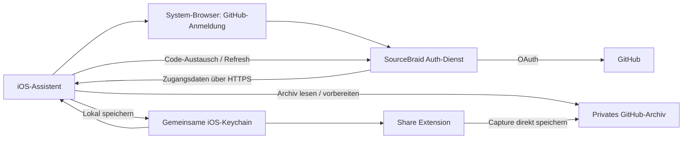

# SourceBraid: Installer-Plan für iOS und iPadOS nach Version 1.1.0

**SourceBraid — Weave the web into Markdown.**

Stand: **15. Oktober 2026 · Revision 2** · Basis: **iOS/iPadOS 1.1.0, Build 11**
· Status: **Neuer Umsetzungsplan; Installer noch nicht implementiert**
· [English version](IOS_ONBOARDING_INSTALLER_PLAN.md)

Diese Fassung ersetzt den Entwurf vom 12. Oktober. Der Maintainer hat die
App-Store-Veröffentlichung von 1.1.0 bestätigt. Geprüfte Quellbasis ist der
Tag `ios-v1.1.0`, Commit `e55f1fc17483096c4c05286713d6725b951d4d06`, verglichen
mit `bb7c77a`. Eine Versionsnummer für den nächsten Installer-Release wird
hier nicht vorweggenommen.

## 1. Empfehlung und Ziel

**Die veröffentlichte iPhone-/iPad-App wird zum zentralen Einrichtungsweg.** Der
„Installer“ ist in erster Linie ein geführter Einrichtungsassistent in der App.
Er verbindet GitHub, legt ein privates Archiv an oder verbindet ein vorhandenes,
prüft dessen Nutzbarkeit und führt zum ersten gespeicherten Beitrag. Chrome
und ChatGPT/Codex werden anschließend als freiwillige Ergänzungen angeboten.

Das Ziel für neue Nutzer lautet: **App installieren → bei GitHub anmelden →
privates Archiv bestätigen → ersten Inhalt speichern.** Niemand muss dafür
Git, einen Branch, einen Personal Access Token oder ein Terminal verstehen.
GitHub-Konto, Anmeldung und ausdrückliche Freigaben bleiben erforderlich;
SourceBraid automatisiert weder Konto-Verifikation noch Zwei-Faktor-Anmeldung.

Empfohlene technische Richtung:

- Eine vom Maintainer registrierte **GitHub App**, die Nutzer für ihr Archiv
  freigeben. Nutzer erstellen keine eigene Entwickler-App.
- Browser-Anmeldung aus iOS mit PKCE und einem kleinen SourceBraid-Dienst für
  den sicheren Austausch und die Erneuerung von Zugangsdaten.
- Direkte Übertragung der Captures zwischen iOS und GitHub. Markdown und
  Git-Historie bleiben maßgeblich; lokale Datenbanken sind wiederaufbaubare Caches.
- Automatische Erstellung eines privaten Archivs nach einem frühen technischen
  Nachweis; ein geführter GitHub-Formularweg bleibt als einfachere erste Stufe.
- Bestehende PAT-Konfigurationen funktionieren weiter. Die manuelle Eingabe
  wandert unter „Erweiterte Einrichtung“.

Reader, Suche, Chat-Oberfläche und Aktualisierung aus 1.1.0 werden weiterverwendet.
Der Installer ergänzt ihren Einstieg und ihre Verbindungsverwaltung. Ein
Update darf bestehende Nutzer nicht erneut durch eine Pflichteinrichtung führen.

Dieses Dokument plant die Arbeit. Es registriert keine GitHub App, betreibt
keinen neuen Dienst und ändert keine bestehenden Datenschutz-Zusagen. Die
[Release-Hinweise](IOS_RELEASE_1.1.0.de.md), der
[Reader-Plan](IOS_READER_INTELLIGENCE_DUO_PLAN.de.md) und die
[offenen Geräteprüfungen](IOS_DEVICE_ACCEPTANCE.de.md) bleiben Referenzen für
den bestehenden Funktionsumfang.

## 2. Ausgangslage im Repository

### Release-Abgrenzung und Änderungen seit dem alten Plan

Die iOS-Laufzeitquellen stimmen mit `ios-v1.1.0` überein. Der Release umfasst
58 geänderte Dateien gegenüber dem Vorgänger. Neu nutzbare Grundlage sind:

- „Neueste“ mit sieben Beiträgen, Markdown-Reader und lokale Volltextsuche.
- Cache-Start ohne erneuten Download aller Texte; ein leerer Cache lädt zunächst
  höchstens sieben Artikeltexte. Suchabdeckung darf ausdrücklich teilweise sein.
- Begrenzte Hintergrundaktualisierung sowie Abbruch- und Cache-Koordination.
- Adaptive Navigation für iPhone/iPad, optionaler lokaler Chat und lesende
  Kurzbefehle. Apple Intelligence bleibt unabhängig von der Einrichtung.

Die Share Extension war bereits vorhanden. GitHub-Anmeldung, Repository-
Erstellung und Token-Erneuerung wurden in 1.1.0 **nicht** ergänzt.

App-Store-Veröffentlichung: durch den Maintainer bestätigt. Quellversion:
durch Git-Tag, Versionsfelder und lokalen Build geprüft. Daraus folgt keine
eigenständige Prüfung des im Store ausgelieferten Binärpakets. Im iOS-Tag sind
Chrome, Codex und MCP noch auf 1.0.1. Die während der Überprüfung separat
eingecheckten Folgearbeiten in `467542a` bereiten diese Komponenten auf 1.1.0
vor; die iOS-Laufzeitquellen bleiben gegenüber dem iOS-Tag unverändert.
Dieser zusätzliche Commit belegt keine öffentliche Plugin-Verfügbarkeit.
Die Folgearbeiten werden durch diesen Plan nicht verändert.

| Bereich | Heute vorhanden | Für einfache Einrichtung fehlt |
| --- | --- | --- |
| [iOS-Einstellungen](../ios/SourceBraid/App/SettingsView.swift), [ViewModel](../ios/SourceBraid/App/SettingsViewModel.swift) | Formular für Owner, Repository, Branch, Archivordner und Token | Geführte Anmeldung, Archivwahl, Erstellung, verständliche Zustände |
| [GitHubClient](../ios/SourceBraid/Shared/GitHubClient.swift) | Repository-Abfrage, Capture-Schreibzugriff | Vollständige Prüfung von Branch, Privatsphäre, Schreibfähigkeit und PDF-Unterstützung |
| [Konfiguration](../ios/SourceBraid/Shared/SourceBraidConfiguration.swift), [Keychain](../ios/SourceBraid/Shared/KeychainStore.swift) | Gemeinsame Einstellungen und ein Token für App/Share Extension | Authentifizierungstyp, Ablauf, Refresh, Kontobindung und sichere Migration |
| [Reader](../ios/SourceBraid/Archive/ArchiveLibrary.swift) | Veröffentlichtes Lesen, Suche, Cache-Start und Neueste sieben | Neues leeres Archiv korrekt behandeln; ersten Capture gezielt zurücklesen |
| [Hintergrundaktualisierung](../ios/SourceBraid/Archive/ArchiveBackgroundRefresh.swift) | Begrenzte Abrufe und koordinierte Cache-Schreibvorgänge | Verbindungsstatus über Neustarts beachten; erneuerbare Credentials integrieren |
| [Kurzbefehle](../ios/SourceBraid/Archive/ArchiveIntents.swift) | Suche und Öffnen bereits geladener Einträge | Neues Credential-Modell übernehmen, lokale Identitäten und Offline-Verhalten erhalten |
| [Setup-Skript](../scripts/setup_github.py), [Paketbau](../scripts/build_setup_package.py) | Privates Repository, Support-Dateien und Konfiguration ohne Token | Python und angemeldetes `gh` sind nötig; am Ende bleibt die manuelle PAT-Erstellung |
| [Chrome-Erweiterung](../chrome-extension/sourcebraid/popup.js) | Manuelle Einstellungen, Capture und Export der Plugin-Konfiguration ohne Token | Anmeldung und Import einer von iOS vorbereiteten Konfiguration |
| [Gehostetes ChatGPT](../chatgpt-mcp/src/auth.mjs) | Vorbereiteter OAuth-Dienst mit nutzerbezogenen Grants | GitHub-Anmeldung statt separatem PAT; Deployment und öffentliche Freigabe |
| [Lokales Codex-Plugin](../codex-plugin/sourcebraid/scripts/sourcebraid.py) | Python-Standardbibliothek, lokale Suche, vorhandene GitHub-Zugangsdaten | Optional vereinfachter Konfigurationsimport; kein Bestandteil des iOS-Grundsetups |

### Konkrete Befunde für die Umsetzung

1. „Verbindung testen“ speichert derzeit die neue Konfiguration vor der
   Netzwerkprüfung. Ein fehlgeschlagener Versuch kann dadurch das bisherige
   Archiv umstellen und dessen lokalen Cache entfernen. Der Assistent braucht
   einen Entwurf, der erst nach erfolgreicher Prüfung aktiv wird.
2. Die aktuelle Verbindungsprüfung liest nur Repository-Metadaten. Das beweist
   weder einen vorhandenen Branch noch einen erfolgreichen Capture. „Verbunden“,
   „Lesen möglich“ und „Speichern bestätigt“ müssen getrennte Zustände werden.
3. Während der Prüfung bleiben Felder und Speichern bedienbar. Die Erfolgsmeldung
   verwendet nach dem Netzwerkaufruf die dann aktuellen Eingaben. Sie kann damit
   ein anderes Repository als das geprüfte nennen. Ein unveränderlicher Entwurf
   mit Versionsprüfung muss Anfrage, Ergebnis und Aktivierung zusammenhalten.
4. Ein fehlender Archivordner erzeugt weiterhin einen 404-Fehler. Die neue
   Leerliste repariert das nicht. Bootstrap und echter Zustand „noch keine
   Beiträge“ müssen von fehlendem Zugriff oder falschem Branch getrennt werden.
5. Nach einem Capture stellt die Rückkehr in die App einen vorhandenen Cache
   wieder her, ohne automatisch einen neuen GitHub-Stand zu laden. Der Assistent
   muss den ersten Capture gezielt abrufen; auf Hintergrundaktualisierung zu
   warten ist kein verlässlicher Abschluss.
6. Die Sperre gegen Hintergrundabrufe nach Abmeldung liegt derzeit nur im
   Arbeitsspeicher. Gespeicherte Repository-Felder bleiben erhalten; nach einem
   Neustart kann die Planung wieder anlaufen, obwohl das Token entfernt wurde.
   Ein dauerhafter Verbindungsstatus muss die Planung und Ausführung begrenzen.

Die Befunde liegen in `SettingsViewModel.testConnection`,
`GitHubClient.testConnection`, `ArchiveReadClient.snapshot`,
`ArchiveLibrary.configure` und `ArchiveBackgroundRefresh.schedule`.
Sie sind Prüfergebnisse dieses Plans und wurden hier nicht im Produktcode behoben.

### Nachweis dieser Überprüfung

- Quellvalidator: **1.1.0/Build 11 bestanden**.
- Unsignierter generischer Simulator-Build mit **Xcode 27.1 / 27A9275 bestanden**;
  das erzeugte App-Bundle besteht ebenfalls den Validator.
- Aktueller iPad-Testlauf und seine Grenzen werden in Abschnitt 12 festgehalten.
- Frühere Zahlen aus dem [Release-Protokoll](IOS_RELEASE_1.1.0.de.md) bleiben
  historische Nachweise. Sie werden nicht als erneut ausgeführte Tests ausgegeben.

Das Setup-Skript ist eine gute Vorlage für erlaubte Dateien und Wiederholbarkeit.
Seine pauschale Aktivierung von GitHub Actions mit `allowed_actions: all` soll
jedoch **nicht** in den neuen Assistenten übernommen werden.

## 3. Was der Installer leisten soll

### Pflichtumfang der ersten nutzerfreundlichen Version

- Einstieg ohne Terminal, Python oder GitHub CLI.
- Erklärung in Alltagssprache: „Dein Archiv ist ein privater Ordner bei GitHub.
  Die Dateien gehören dir und bleiben unabhängig von SourceBraid nutzbar.“
- Anmeldung bei GitHub, verständliche Repository-Freigabe, Kontoanzeige.
- Neues privates Archiv oder vorhandenes Archiv verbinden.
- Technische Felder automatisch ermitteln; nur bei Bedarf unter „Erweitert“.
- Initialisierung, Wiederaufnahme nach Abbruch und Prüfung mit konkreten
  Handlungsoptionen bei Fehlern.
- Einführung in die iOS-Teilen-Funktion und erster echter Capture mit Rücklesen.
- Ein später erreichbarer Bereich „Verbindungen“ für Erneuerung und Reparatur.
- Vollständige deutsche und englische Texte, VoiceOver und Dynamic Type.
- Bestandsnutzer direkt zum Reader führen; PAT-Migration freiwillig anbieten.
- Ein iPad ohne vorherige iPhone-Einrichtung vollständig einrichten können.
- Auf einem zweiten Gerät das vorhandene Archiv verbinden, statt ein Duplikat
  anzulegen. Jede Installation meldet sich eigenständig bei GitHub an.

### Bewusst später

PDF-Konvertierung, Chrome-Verknüpfung, gehostetes ChatGPT und lokale
Codex-Einrichtung dürfen den erfolgreichen Grundstart nicht blockieren. Auch
Apple Intelligence ist keine Voraussetzung. Ein separater Desktop-Installer
ist zunächst nachrangig; das vorhandene Skript bleibt für technische Nutzer und
als unabhängiger Weg ohne iPhone erhalten. Android bleibt Roadmap.

## 4. Anmeldung: Optionen und Entscheidung

| Option | Vorteil | Aufwand und Einschränkung | Einordnung |
| --- | --- | --- | --- |
| Geführter Fine-grained PAT | Kleine Änderung; vorhandene Clients bleiben kompatibel | Token muss weiter erstellt, kopiert und später ersetzt werden | Übergang und Expertenweg |
| GitHub App, Browser-Flow + PKCE + Auth-Dienst | Verständliche Anmeldung; gezielte Repository-Freigabe; automatische Erneuerung | Betrieb eines kleinen Dienstes und neuer Umgang mit Zugangsdaten | Empfohlenes Produktziel |
| GitHub App, Device Flow | Kein App-Secret im Client; kein eigener Token-Austauschdienst notwendig | Codeeingabe, Polling und erhöhte Phishing-Angriffsfläche | Begründete Alternative prüfen, kein iOS-Standard |
| OAuth App | Bekannter Anmeldeweg | Private Repositories benötigen typischerweise den breiten `repo`-Zugriff | Gegenüber GitHub App nachrangig |
| Desktop-Skript mit `gh auth login` | Vieles bereits vorhanden | Zusätzliche Installation und Terminalwissen | Ergänzung für Fortgeschrittene |

Zum Vergleich der OAuth-App-Reichweite:
[GitHub: OAuth-Scopes](https://docs.github.com/en/apps/oauth-apps/building-oauth-apps/scopes-for-oauth-apps).

GitHub dokumentiert PKCE im Web-Flow, verlangt beim Code-Austausch aber weiterhin
ein `client_secret`. Deshalb verspricht der Plan keinen rein nativen,
secretfreien Web-Flow. Der Auth-Dienst ist unsere Architekturentscheidung, um
dieses Secret serverseitig zu halten.
[GitHub: User-Access-Token-Flow](https://docs.github.com/en/apps/creating-github-apps/authenticating-with-a-github-app/generating-a-user-access-token-for-a-github-app#using-the-web-application-flow-to-generate-a-user-access-token)

GitHub bevorzugt PKCE gegenüber Device Flow und empfiehlt Letzteren nur mit
begründetem Bedarf in eingeschränkten Umgebungen. Auch ein natives eingebautes
Client-Secret wäre nicht vertraulich. Deshalb wird Device Flow nicht allein
wegen eingesparter Serverarbeit zum Standard.
[GitHub: Best Practices](https://docs.github.com/en/apps/creating-github-apps/about-creating-github-apps/best-practices-for-creating-a-github-app#client-secrets)

Für den bestehenden PAT-Weg können Name, Owner, Ablauf und Contents-Recht über
einen GitHub-Link vorbefüllt werden. Die Auswahl des einen Archiv-Repositories
muss der Nutzer prüfen; der Link erstellt keinen Token automatisch. Tokens
gehören ausschließlich in das geschützte Eingabefeld, niemals in Chat, QR-Code,
Support-Ticket oder Konfigurationsexport.
[GitHub: PAT-Vorlagen](https://docs.github.com/en/authentication/keeping-your-account-and-data-secure/managing-your-personal-access-tokens#pre-filling-fine-grained-personal-access-token-details-using-url-parameters)

## 5. Ablauf aus Nutzersicht

| Schritt | Anzeige und Aktion | Was SourceBraid übernimmt |
| --- | --- | --- |
| 1. Willkommen | „Dein eigenes Wissensarchiv“; „Einrichten“ | Kurze Erklärung zu GitHub und privatem Eigentum; bestehende Nutzer überspringen diesen Schritt |
| 2. GitHub verbinden | „Mit GitHub verbinden“; alternativ „GitHub-Konto erstellen“ | Browser-Anmeldung, Rückkehr und Prüfung des angemeldeten Kontos |
| 3. Archiv wählen | „Neues privates Archiv“ oder „Vorhandenes Archiv“ | Vorschlag `sourcebraid-archive`, Kollisionsprüfung und bestehende Auswahlmöglichkeiten |
| 4. Zugriff bestätigen | GitHub zeigt SourceBraid und die freizugebenden Repositories | Anleitung für genau das Archiv; Rückprüfung der tatsächlichen Installation |
| 5. Archiv vorbereiten | „Archiv wird vorbereitet“ mit benannten Teilschritten | Branch bestimmen, Archivordner mit `.gitkeep` initialisieren, vorhandene Dateien erhalten |
| 6. Erstes Speichern | Kurze Anleitung für Safari → Teilen → SourceBraid | Tatsächlichen Capture speichern, gezielt abrufen und im vorhandenen Reader öffnen |
| 7. Fertig | „Dein Archiv ist bereit“ | Optional PDF, Chrome oder ChatGPT verbinden; alles überspringbar |

Die Reihenfolge von Archiv-Erstellung und Installationsfreigabe hängt vom
gewählten Bootstrap-Verfahren ab; die Oberfläche zeigt nur den jeweils nötigen
nächsten Schritt. Die GitHub-Anmeldung und die Installation der GitHub App sind
unterschiedliche Freigaben. Eine erfolgreiche Anmeldung allein bedeutet noch
keinen Archivzugriff.

Standardwerte gelten nur für neue Archive. Vorhandene Namen, Ordner und Branches
werden nicht umbenannt. Insbesondere wird der tatsächliche Default-Branch
ermittelt, statt überall `main` anzunehmen. Der bisherige Name
`sourcebraid-private` ist kein Beweis für Privatsphäre und darf nicht mit dem
privaten Autoren-Repository des Maintainers verwechselt werden.

Kein Test erzeugt heimlich einen scheinbar echten Artikel. Eine optionale
synthetische Einrichtungsdatei muss als solche angekündigt sein. Für den
Abschluss ist ein vom Nutzer gestarteter Capture mit korrekter Herkunft der
aussagekräftigste Nachweis. Reiner Lesezugriff bleibt ein nutzbarer Modus mit
dem Hinweis „Zum Speichern fehlt die Freigabe“.

### Einstiege für neue und bestehende Installationen

| Ausgangslage | Einstieg | Erfolg |
| --- | --- | --- |
| Neues iPhone oder iPad ohne Konfiguration | Assistent ersetzt „Archiv verbinden → Einstellungen“ und den leeren Reader-Platzhalter | Privates Archiv verbunden; erster Capture abrufbar |
| Update einer funktionierenden 1.1.0-Installation | Direkt „Zuletzt“, optionaler Hinweis in „Verbindungen“ | Bestehendes Archiv und Cache bleiben nutzbar |
| Zweites Gerät / Neuinstallation | „Vorhandenes Archiv verbinden“ deutlich anbieten | Dasselbe Repository auswählen, eigenes Credential erhalten |
| Abgelaufenes oder widerrufenes Credential | Reparatur der Verbindung statt neuer Archiv-Erstellung | Identität bestätigen und Zugriff erneuern |
| Nur Leserechte | Reader und Suche mit klarer Kennzeichnung | Lesen unabhängig von Capture nutzbar |

Die vorhandene synthetische Demo ist ein Debug-/Testmodus und keine
veröffentlichte Kundenfunktion. Eine öffentliche Vorschau wäre eigene Arbeit
und ist keine Voraussetzung für diesen Installer.

### iPhone und iPadOS

Ein gemeinsamer `OnboardingCoordinator` steuert denselben fachlichen Ablauf.
Auf dem iPhone und in schmalen iPad-Fenstern wird jeweils ein Schritt gezeigt;
ein breites iPad-Fenster kann Fortschritt und Erklärung neben dem aktuellen
Formular darstellen. Seitenwechsel, Scrollposition und Eingaben bleiben bei
Rotation, Größenwechsel und Browser-Rückkehr erhalten. Keine festen
Bildschirmbreiten und kein Zwang zum Vollbild.

Tastatur, Tab-Navigation, sichtbarer Fokus, VoiceOver, große Schrift sowie
Hoch-/Querformat gehören zur Abnahme. Die vorhandene adaptive Navigation wird
weiterverwendet; ein iPad wird nicht lediglich als vergrößertes iPhone getestet.

Mehrere gleichzeitig nutzbare App-Fenster werden durch `WindowGroup` allein
nicht nachgewiesen und sind kein stillschweigendes neues Release-Versprechen.
O00 prüft Scene-Konfiguration und tatsächliche Fensterunterstützung. Der
Verbindungskoordinator erlaubt höchstens eine aktive Anmeldung/Übernahme
appweit. Weitere unterstützte Fenster zeigen den Vorgang, statt einen zweiten
zu starten. Späte Ergebnisse eines geschlossenen oder überholten Assistenten
dürfen keine neuere Verbindung überschreiben.

## 6. Technische Architektur für iOS und iPadOS

Apple stellt mit `ASWebAuthenticationSession` einen Systemweg für die
Web-Anmeldung bereit. Wir verwenden ihn anstelle eines selbst gebauten
Passwortformulars oder der Capture-WebView. Die Umsetzung berücksichtigt die
vorhandene iOS-17-Unterstützung und prüft Callback-APIs auf Verfügbarkeit.
[Apple: ASWebAuthenticationSession](https://developer.apple.com/documentation/authenticationservices/aswebauthenticationsession)

Der Presentation-Anchor kommt aus dem Fenster, das die Anmeldung gestartet
hat. Sitzung und Presentation-Delegate werden bis zum Abschluss gehalten;
kein globales „erstes Fenster“ aus allen Scenes. Ein Startfehler oder Abbruch
kehrt zum vorhandenen Entwurf zurück.
[Apple: Web-Anmeldung](https://developer.apple.com/documentation/authenticationservices/authenticating-a-user-through-a-web-service)

Der neuere HTTPS-Callback benötigt iOS/iPadOS 17.4 und eine zugeordnete Domain.
Bei weiterhin unterstütztem OS 17.0–17.3 ist ein geprüfter älterer
Custom-Scheme-Callback mit PKCE und Zustandsbindung nötig. Callback-APIs und
Associated Domains sind neue Konfiguration, kein Bestand von 1.1.0. Eine
Anhebung der Mindestversion ist in diesem Plan nicht vorgesehen.
[Apple: Callback-API](https://developer.apple.com/documentation/authenticationservices/aswebauthenticationsession/callback)



### Aufgaben des Auth-Dienstes

Der Dienst hält das Client-Secret in einer geschützten Server-Umgebung und
unterstützt Anmeldung und Refresh. Er ist kein Proxy für Archivdateien und
benötigt im Grundmodell keinen GitHub-App-Privatschlüssel zum Minten von
Installationstokens. iOS verwendet nutzerbezogene GitHub-App-Tokens.

Geplanter Vertrag:

1. iOS beginnt eine kurzlebige Anmeldung mit zufälligem `state` und PKCE S256.
2. Der Dienst bindet die Transaktion an die initiierende App-Sitzung und eine
   exakt erlaubte Callback-Adresse; keine frei übergebenen Weiterleitungsziele.
3. GitHub authentifiziert den Nutzer. Bei Rückkehr werden Zustand, Ablauf und
   die Bindung an die ursprüngliche Anfrage geprüft.
4. Ein einmaliger Rückkehrcode wird aus der App über HTTPS eingelöst. Verifier
   und Code-Austausch müssen dieselbe PKCE-Transaktion bilden. GitHub-Tokens
   dürfen nicht in Callback-URLs oder Browser-Verläufen landen.
5. Der Dienst tauscht den GitHub-Code mit dem serverseitigen Secret aus und
   liefert die Tokens ausschließlich an die initiierende App. Die App prüft
   GitHub-Identität und Archivzugriff vor Aktivierung.
6. Token-Erneuerung erfolgt über einen geschützten, sitzungsgebundenen Endpunkt.
   Er darf kein offener Token- oder beliebiger HTTP-Proxy sein.

Der Broker-Sitzungsnachweis muss auch nach App-Neustart und abgelaufenem
GitHub-Access-Token überprüfbar bleiben. O00 legt seine sichere Speicherung,
Bindung an die autorisierte Verbindung, Laufzeit, Erneuerung und seinen
Widerruf fest. Ein gewöhnlicher Refresh soll keine neue Browser-Anmeldung
erfordern; eine abgelaufene oder widerrufene Broker-Sitzung darf sie verlangen.

Das ist ein zu prüfender Schnittstellenentwurf, kein neues selbst erfundenes
OAuth-Protokoll. Eine gepflegte OAuth-Implementierung und ein Security-Review
müssen Replay, Login-CSRF, App-Imitation und fehlgeschlagene Übergaben abdecken.

**Datenschutzwirkung:** Der Dienst verarbeitet Tokens zumindest kurzzeitig und
kann deshalb nicht als „ohne Zugriff auf Zugangsdaten“ beworben werden.
Vorgeschlagen sind keine dauerhafte Token-Speicherung für iOS, keine
Inhaltsdatenbank und keine Protokollierung von Tokens, Codes oder Request-Bodies.
Kurzlebige Sitzungsdaten, Betriebsmetadaten, Löschfristen, Hosting und
Secret-Rotation sind vor Veröffentlichung festzulegen. Die bestehende
Cloudflare-Infrastruktur ist ein möglicher Betreiberpfad, keine bereits
vorhandene native Anmeldelösung.

### Konsistente Verbindung statt einzelner Token-Zeichenfolge

Die neue Verbindung erhält eine stabile lokale ID und eine Revision. Ein
`CredentialProvider` liefert Zugangsdaten und die zugehörige GitHub-/Archiv-
Identität zusammen. Einstellungen, Reader und Extension dürfen nicht zu
verschiedenen Zeitpunkten einen neuen Owner und ein altes Token kombinieren.

Keychain und App-Group-Defaults bilden keine gemeinsame Datenbanktransaktion.
Deshalb wird eine neue Credential-Version zunächst getrennt vorbereitet und
geprüft, dann unter Koordination über einen aktiven Verweis freigegeben.
Teilweise geschriebene Zustände müssen nach Prozessabbruch erkannt werden;
bis zur erfolgreichen Übernahme bleibt die letzte gültige Verbindung aktiv.
Ein konkreter Commit-/Wiederherstellungsvertrag gehört in O01.

Ein gleiches Archiv mit erneuertem Credential behält Cache und Kurzbefehls-IDs.
Ein expliziter Archivwechsel nutzt die vorhandene Invalidierung und
Cache-Bereinigung erst nach erfolgreicher Übernahme. Alle laufenden Vorgänge
prüfen ihre Verbindungsrevision vor Übernahme eines Ergebnisses. Beim Wechsel
wird ein begonnener Capture kontrolliert beendet oder abgebrochen, niemals
gegen das inzwischen neu ausgewählte Repository wiederholt.

### Lebenszyklus aller Credential-Verbraucher

Die gemeinsame Keychain erhält ein versioniertes Credential-Modell mit
Auth-Typ, stabiler GitHub-Nutzer-ID, App-/Installationsbezug, Access- und
Refresh-Token sowie Ablaufzeiten. Nicht geheime Archivkonfiguration bleibt
getrennt. Bestehende Keychain- und App-Group-Identitäten bleiben erhalten.

| Verbraucher in 1.1.0 | Anpassung für erneuerbare Credentials |
| --- | --- |
| `SettingsViewModel` und Assistent | Unveränderlichen Entwurf prüfen; nur dieselbe Revision aktivieren |
| `ArchiveLibrary` / `ArchiveReadClient` | Credential vor Requests beziehen; Tokenwechsel im selben Archiv ohne Cache-Löschung |
| `ArchiveBackgroundRefresh` | Nur mit dauerhaft freigegebener Verbindung planen; begrenzter Refresh oder sauberer Abbruch, kein Login-Dialog |
| `GitHubClient` / `ShareViewModel` | Zusammengehörige Konfiguration und Credentials laden; Wechsel während Bildabruf/Upload erkennen |
| `ArchiveIntents` | Lokale Geräteauthentifizierung und Cache-Zugriff erhalten; keine interaktive Anmeldung oder Repository-Erstellung aus Kurzbefehlen |

Der vorhandene `ArchiveRefreshCoordinator` schützt Cache-Schreibvorgänge im
App-Prozess. Er ersetzt keine prozessübergreifende Token-Sperre mit der Share
Extension. Das neue Credential-Modell muss beide Koordinationsebenen verbinden,
ohne die vorhandenen Abbruch- und Löschschutzmechanismen zu entfernen.

GitHub dokumentiert standardmäßig acht Stunden für User Access Tokens und
sechs Monate für Refresh Tokens; bei erfolgreichem Refresh wird das alte Paar
ungültig. Die Implementierung verwendet die gelieferten Ablaufwerte und prüft
die tatsächlich aktivierte App-Konfiguration.
[GitHub: Refresh](https://docs.github.com/en/apps/creating-github-apps/authenticating-with-a-github-app/refreshing-user-access-tokens)

App und Share Extension dürfen nicht gleichzeitig dasselbe Refresh-Token
verbrauchen. Benötigt werden eine prozessübergreifende Koordination, erneutes
Lesen nach Sperrerwerb und atomisches Ersetzen des Credential-Satzes. Nach einem
Timeout beim Refresh gibt es keine blinde Wiederholungsschleife; bei verlorenem
neuem Tokenpaar ist eine erneute Anmeldung ein vorgesehener Wiederherstellungsweg.
Die Extension hat einen kurzen Zeitrahmen: nötigenfalls verständlich auf
„SourceBraid öffnen und Verbindung erneuern“ verweisen. Ein fehlgeschlagener
Upload darf nie als gespeichert gelten.

Das bestehende Keychain-Item ist nicht synchronisierbar und gerätegebunden.
Ein neu eingerichtetes iPad übernimmt deshalb kein iPhone-Token. Der Standard
bleibt: auf dem zweiten Gerät anmelden und dasselbe Archiv auswählen.
Authentifizierungsgeheimnisse gehören weder in `SceneStorage` noch in
Konfigurationsdateien. Dort beziehungsweise in der Wiederherstellung des
Assistenten werden ausschließlich nicht geheime Schritte und Eingaben gespeichert.
Dauerhafte Zugangsdaten und Broker-Sitzungsnachweise bleiben in der Keychain;
nicht gesicherte Anmeldeversuche beginnen nach Prozessverlust neu.
[Apple: Gerätegebundene Keychain](https://developer.apple.com/documentation/security/ksecattraccessibleafterfirstunlockthisdeviceonly)

Abmeldung und Widerruf invalidieren ausstehende Login-/Refresh-Ergebnisse.
Ein danach eintreffendes Token darf die Verbindung nicht wieder aktivieren.
Ein dauerhaft gespeicherter Zustand `signedOut` unterbindet Hintergrundjobs
auch nach App-Neustart. „Offline mit gültiger lokaler Verbindung“ und
„abgemeldet“ bleiben unterschiedliche Zustände; lesbarer Cache darf nicht
bei jedem Netzfehler verschwinden.

Insbesondere bleibt die lokale Verbindung zum Offline-Lesen und Suchen nutzbar,
wenn lediglich das kurzlebige Access Token abgelaufen und der Auth-Dienst nicht
erreichbar ist. Netzwerk-Token-Gültigkeit und lokale Zugriffsfreigabe sind
getrennte Bedingungen. Explizites Abmelden oder Entfernen lokaler Daten behält
seine bisherige Wirkung; ein fehlgeschlagener Refresh löscht keinen Cache.

## 7. Archiv-Erstellung und Berechtigungen

### A. Kleinster veröffentlichbarer Weg

Der Assistent öffnet ein vorbereitetes GitHub-Formular für ein privates
Repository. Danach führt er zur Installation der GitHub App mit Auswahl des
Archivs. Er prüft anschließend API-seitig Repository-ID, Owner, Privatstatus
und tatsächlichen Zugriff; Formularwerte und Rückkehrparameter sind keine
vertrauenswürdige Bestätigung.

Beispiel für den dokumentierten Formularweg:
[Privates Archiv bei GitHub vorbereiten](https://github.com/new?name=sourcebraid-archive&visibility=private&owner=%40me).
[GitHub: Repository-Formularparameter](https://docs.github.com/en/repositories/creating-and-managing-repositories/creating-a-new-repository#creating-a-new-repository-from-a-url-query)

### B. Bevorzugtes Komfortziel: Erstellung direkt aus der App

Die aktuelle GitHub-Dokumentation nennt **Repository creation** als engeres
Recht als Administration und beschreibt automatischen Zugriff auf selbst
erstellte Repositories. Damit ist die direkte Erstellung grundsätzlich planbar.
[GitHub: Berechtigungswahl](https://docs.github.com/en/apps/creating-github-apps/registering-a-github-app/choosing-permissions-for-a-github-app)

Nach Installation/Autorisierung ruft iOS `POST /user/repos` auf, ausdrücklich
mit `private: true`. Die Antwort liefert die zu prüfende Repository-ID. Danach
wird der Zugriff erneut über die Installation festgestellt und das Archiv
initialisiert. Das öffentliche API-Default darf nie versehentlich verwendet
werden.
[GitHub: Repository erstellen](https://docs.github.com/en/rest/repos/repos?apiVersion=2026-03-10#create-a-repository-for-the-authenticated-user)

**Früher Nachweis O00:** frisches Konto ohne Repository, tatsächliche
Verfügbarkeit des Creation-Rechts, Installation mit null/ausgewählten
Repositories, automatischer Zugriff, bestehende Installation mit abgelehntem
Rechte-Upgrade, Namenskollision und Timeout direkt nach Erstellung. Diese
Choreografie wurde für diesen Plan nicht praktisch ausgeführt. Scheitert der
Nachweis, wird zunächst Weg A umgesetzt. Kein pauschales Ausweichen auf
Administrationsrechte oder alle Repositories.

### Berechtigungsmodell als Umsetzungsziel

| Funktion | Geplanter Zugriff | Abgrenzung |
| --- | --- | --- |
| Lesen | Metadata und Contents lesen | Eigenständiger Lesemodus |
| Capture | Contents schreiben im ausgewählten Archiv | Keine allgemeinen Repository-Administrationsrechte |
| Neues Archiv | Separat begründetes Repository-creation-Recht für Weg B | Weg A benötigt keine Erstellungsvollmacht |
| PDF einrichten | Contents plus Workflows schreiben für die Support-Dateien | Separater Einrichtungsschritt, kein Capture-Standardrecht |
| PDF-Status | Nur falls nötig Actions lesen | Keine automatische Änderung von Organisationsrichtlinien |
| Gehostetes ChatGPT | Eigene, auf Lesen begrenzte GitHub-Verbindung | Kein Weiterreichen des iOS-Schreib-Tokens |

Die konkreten API-Endpunkte und Rechte werden in O00 mit minimalen Testkonten
verifiziert; insbesondere der
[Contents-Schreibzugriff](https://docs.github.com/en/rest/repos/contents#create-or-update-file-contents)
für normale Dateien und Workflow-Dateien. GitHub-App-Rechte sind an die Registrierung gebunden
und keine frei wechselnden OAuth-Scopes. Ein optionaler PDF-Schalter macht ein
global angefordertes Workflow-Recht nicht nachträglich optional. Für die erste
Version: PDF-Setup über einen getrennten, eng begrenzten Einrichtungsweg; später
gegebenenfalls eigene Setup-App. Jede zusätzliche App erhöht die Bedienkomplexität
und muss einen nachweisbaren Nutzen haben.

Auch „Nur lesen“ in der Oberfläche reduziert ein bereits erteiltes GitHub-Recht
nicht. Bestehende Contents-Read-PATs bleiben für diesen Modus unterstützt. Die
Capture-GitHub-App fordert Contents-Schreibrechte; eine garantiert nur lesende
OAuth-Anmeldung braucht eine entsprechend getrennte Rechte-Registrierung und
wird nicht als bereits gelöste Eigenschaft des Capture-Logins versprochen.

Vorhandene Archive werden nur nach Auswahl verbunden. Persönliche Konten sind
der erste voll unterstützte Einrichtungsweg; Organisationen, SSO und ausstehende
Admin-Freigaben erhalten eigene Zustände. Regeln oder Branch-Schutz werden nicht
abgeschaltet, um einen Capture durchzusetzen.

## 8. Initialisierung und PDF-Konvertierung

### Erster Capture im veröffentlichten Reader

1. Neues Archiv mit initialem Commit und `.gitkeep` herstellen; leeren Zustand
   ausdrücklich anzeigen. Ein 404 wegen fehlender Freigabe bleibt ein Fehler.
2. Den Nutzer einen öffentlichen Beispielinhalt seiner Wahl oder eigene
   freigegebene Inhalte über die echte Share Extension speichern lassen.
3. Den erfolgreichen Capture mit Archividentität, Pfad und vorhandenem
   Commit-/Dateinachweis verbinden; kein zusätzliches Token im Rückkehrhinweis.
4. Bei Rückkehr den gespeicherten Pfad gezielt lesen oder begrenzt den
   Archivstand aktualisieren. Der aktuelle reine Cache-Start genügt hier nicht.
5. Den Beitrag im vorhandenen Reader öffnen und „Speichern geprüft“ setzen.
   Ein fehlgeschlagener Abruf lässt den Schritt offen, ohne den Upload sofort
   zu wiederholen und doppelte Captures zu erzeugen.

Der Assistent wartet weder auf einen vollständigen Suchindex noch auf einen
vom Betriebssystem gestarteten Hintergrundjob. Die Grenze von sieben ersten
Artikeltexten bleibt erhalten; ein gezielter Capture-Nachweis wird separat
begrenzt. Für vorhandene große Archive darf die Einrichtung keinen Vollabruf
auslösen. „Archiv verbunden“, „Speichern geprüft“ und „Suchabdeckung“ sind
unabhängige Anzeigen.

### Wiederholbarer Bootstrap

Der Bootstrap bekommt eine explizite Dateiliste und wird wiederholbar:

- Neues Archiv mit initialem Commit und `<Archivordner>/.gitkeep` vorbereiten.
  Git speichert keine leeren Verzeichnisse. Ein Archiv ohne Captures ist danach
  ein gültiger Zustand; auch ein noch nicht angelegter Archivordner muss beim
  ersten Einrichten verständlich behandelt werden.
- Nur geplante Dateien anlegen. Bestehende Dateien vergleichen und erhalten;
  Konflikte anzeigen. Kein Überschreiben aus Bequemlichkeit.
- Nach unklarer Netzwerkantwort zuerst remote prüfen, ob der Schritt schon
  ausgeführt wurde. Kein zweites Repository oder doppelter Test-Capture.
- Einrichtungsschritte und verbleibende Arbeit ohne Geheimnisse dokumentieren.
  Abbruch löscht kein bereits angelegtes Repository.
- Format von Capture-Pfaden, YAML-Frontmatter und URL-Hash-Index-Shards erhalten.
  Ein neues Konfigurationsschema benötigt explizite Versionierung und Migration.

PDF bleibt ein eigener Schritt „PDFs automatisch in Markdown umwandeln“.
Wiederverwendet wird die bestehende Allowlist:

```text
.github/workflows/convert-pdfs.yml
requirements-docling.txt
scripts/convert_pdfs.py
scripts/push_with_retry.py
```

Die Dateien stammen aus den geprüften öffentlichen Projektquellen und werden
versionsgebunden gebündelt. Weder `website/` noch ein privates `web-clips/`,
lokale Konfiguration oder Git-Historie werden kopiert. Es wird auch nicht das
private Autoren-Repository geforkt oder exportiert.

Der PDF-Schritt erläutert Verarbeitung durch GitHub Actions und mögliche
Kontingente/Kosten, ohne einen unbegrenzt kostenlosen Betrieb zu versprechen.
Ein synthetisches PDF prüft den tatsächlichen Durchlauf. „PDF hochgeladen“,
„Konvertierung ausstehend“ und „Markdown verfügbar“ bleiben getrennt. Bei
deaktivierten Actions bleiben normales Speichern, Lesen und Suche nutzbar;
ausstehende PDF-Konvertierung wird sichtbar, statt als abgeschlossen zu gelten.

## 9. Chrome, ChatGPT und Codex ergänzend verbinden

### Chrome

Der vorhandene Teilen-Button im Reader exportiert Markdown-Inhalt. Ein Export
von Repository-Einstellungen aus iOS ist weiterhin eine geplante neue Funktion.

Nach dem iOS-Grundsetup kann die App eine Konfiguration ohne Zugangsdaten
bereitstellen. Die existierenden Schlüssel bleiben kompatibel:

```json
{
  "owner": "example-user",
  "repo": "sourcebraid-archive",
  "branch": "main",
  "root_folder": "web-clips"
}
```

Das ist ein synthetisches Beispiel, keine reale Konfiguration. Chrome braucht
zunächst einen Importdialog mit Vorschau, strikter Pfadprüfung und eigener
GitHub-Anmeldung. Importierte Werte verleihen keinen Zugriff. OAuth-Callbacks,
Manifest-V3-Service-Worker-Neustarts und eventuell nötige neue Browserrechte
werden gezielt geprüft. Es werden keine iOS-Tokens, Cookies oder Refresh-Tokens
in die Erweiterung übertragen.

Eine spätere Kopplung per QR-Code darf nur Konfiguration oder einen kurzlebigen,
einmaligen, sitzungsgebundenen Kopplungsnachweis enthalten. Repository-Namen sind
ebenfalls privat zu behandeln. Installation und Freigabe der Chrome-Erweiterung
erfolgen im Browser; die iOS-App kann sie anleiten, aber nicht still installieren.

### Gehostetes ChatGPT

Die [vorbereitete MCP-Anbindung](CHATGPT_MCP_DEPLOYMENT.md) hat bereits
nutzerbezogene OAuth-Grants. Ihr OAuth verbindet jedoch **ChatGPT mit
SourceBraid**. Auf der Zustimmungsseite wird weiterhin ein separater GitHub-PAT
verlangt. Diese Anmeldung löst das GitHub-Tokenproblem noch nicht.

Der Ausbau benötigt eine eigenständige, lesende GitHub-Anbindung, vorzugsweise
eine separate GitHub-App-Registrierung ohne Schreibrechte. Zustimmung und
Zuordnung zu Nutzer, Installation und genau einem Archiv werden serverseitig
geprüft. Der vorhandene Code akzeptiert explizit `github_pat_` und ermittelt die
Identität über `/user`; Installationstokens sind daher kein austauschbarer
Ersatz. Credential-Typ, Autorisierung und Erneuerung müssen gezielt angepasst
und mit zwei getrennten Testkonten geprüft werden.

Zwischen ChatGPT und MCP bleiben eigener OAuth-Flow mit PKCE, Ressourcenbindung
und Tokenprüfung nötig. Ein GitHub-Token ist kein MCP-Zugangstoken.
[OpenAI: Plugin-Authentifizierung](https://developers.openai.com/plugins/build/auth)

Dieser gehostete Weg verarbeitet angeforderte Inhalte bei SourceBraid/Cloudflare
und OpenAI. Er erhält eine eigene Einwilligung und Datenschutzbeschreibung.
Das iPhone wird nicht zum dauerhaft erreichbaren MCP-Server. Die Verbindung
muss unabhängig vom laufenden iPhone funktionieren. Öffentliche Verfügbarkeit
wird erst nach Deployment, Tests und Freigabe angekündigt; die App zeigt zuvor
keinen scheinbar funktionierenden Verbindungsbutton.

### Lokales Codex-Plugin

Der vorhandene Weg mit lokaler Python-Laufzeit und GitHub-Zugang bleibt bestehen.
Die Konfiguration aus iOS kann ihn später vereinfachen. Die Standardbibliothek
bleibt ausreichend; für diesen Plan ist kein neues Python-Paket nötig. Lesen
und bestätigte Schreib-/Löschaktionen behalten getrennte Anforderungen. Kein
ChatGPT- oder Codex-Konto ist für die iOS-Grundfunktionen erforderlich.

## 10. Zustände, Fehler und Wiederherstellung

Der Assistent speichert einen Entwurf getrennt von der aktiven Konfiguration.
Ein möglicher Ablauf ist:

```text
unconfigured → authenticating → choosingArchive → authorizingArchive
→ provisioning → readReady → captureVerified → completed
```

`cancelled`, `offline`, `authorizationPending`, `reauthRequired` und
`repairRequired` sind wiederaufnehmbare Zustände. PDF und Zusatzintegrationen
sind separate Fähigkeiten und keine Pflichtzustände dieser Kette.

`readReady` ist ein eigenständiger nutzbarer Endpunkt für Lesebetrieb.
`captureVerified` verlangt einen tatsächlichen Schreib-/Rücklese-Nachweis.
„Einrichtung erledigt“ wird daher immer zusammen mit dem gewählten Lese- oder
Capture-Modus gespeichert; eine unvollständige Suche blockiert beide nicht.

### Migration von 1.1.0

1. Legacy-Konfiguration und vorhandenes PAT lesen, ohne sie umzuschreiben.
   Funktionierende Installationen starten weiterhin im Reader.
2. Unter „Verbindungen“ freiwillig „GitHub-Anmeldung einrichten“ anbieten;
   Owner, Repository, Branch und Root aus der bestehenden Verbindung übernehmen.
3. Neue Anmeldung und Archivzugriff im getrennten Entwurf prüfen. Abbruch
   erhält das alte PAT und den vollständigen bisherigen Verbindungszustand.
4. Erfolgreiche Verbindung einmalig und wiederherstellbar aktivieren; alle
   Verbraucher auf dieselbe Revision umstellen. Im selben Archiv Cache und
   `cacheKey:path`-Identitäten der Kurzbefehle beibehalten.
5. Altes PAT erst nach gesicherter Übernahme lokal entfernen. GitHub-Widerruf
   separat erläutern, da das PAT möglicherweise noch in Chrome verwendet wird.
6. Bei späteren Fehlern zunächst die neue Verbindung reparieren. Kein stiller
   Rückfall auf ein schon widerrufenes PAT und keine neue Archiv-Erstellung.

| Situation | Nutzerführung / gefordertes Verhalten |
| --- | --- |
| Anmeldung abgebrochen | Zur vorherigen Seite; bestehende Verbindung bleibt aktiv |
| Falsches GitHub-Konto | Konto sichtbar anzeigen und gezielten Kontowechsel anbieten |
| 401 / Token widerrufen | Einmal sinnvoll erneuern oder neu anmelden; keine Endlosschleife |
| 403 / fehlendes Recht | Fehlende Freigabe benennen; Organisationsfreigabe und Rate Limit unterscheiden |
| 404 | Fehlende Sichtbarkeit, falsches Repository, fehlenden Branch und leeres Archiv unterscheiden |
| Repository öffentlich | Im Anfängerweg private Alternative verlangen; bestehendes Repository nicht automatisch umstellen |
| Name belegt | Vorhandenes Archiv prüfen oder anderen Namen vorschlagen; nichts überschreiben |
| Geschützter Branch | Blockade erläutern; erlaubten Branch explizit wählen, Schutz erhalten |
| Abbruch nach Erstellung | Vorhandenes Repository finden und fortsetzen; keine automatische Löschung |
| Offline / Rate Limit | Fortschritt erhalten, Wiederholung mit Backoff, vorhandenen Cache nutzbar halten |
| Gerät neu / App neu installiert | Erneut anmelden und vorhandenes Archiv wählen; keine doppelte Erstellung |
| Share Extension ohne gültigen Zugriff | Klare Fehlermeldung und Reparatur in der Haupt-App |

„Auf diesem Gerät abmelden“, „GitHub-Freigabe widerrufen“, „lokale Daten entfernen“
und „Repository löschen“ sind unterschiedliche Aktionen. Der Assistent löscht
keine Archive. Ein Widerruf der GitHub-App-Autorisierung kann weitere Geräte
betreffen; unabhängiger Gerätewiderruf wird ohne Nachweis nicht versprochen.
[GitHub: Autorisierung widerrufen](https://docs.github.com/en/apps/using-github-apps/reviewing-and-revoking-authorization-of-github-apps)

## 11. Umsetzungspakete und Reihenfolge

Die Schätzungen sind Personentage für Entwicklung und Tests, keine Zusagen.
App-Store-Prüfung, Betreiberfreigaben und Wartezeiten sind nicht enthalten.

| Paket | Arbeit und betroffene Bereiche | Ergebnis / Abnahme | Grobe Größe |
| --- | --- | --- | --- |
| O00 – Machbarkeit nach 1.1.0 | Test-GitHub-App, Web-Flow/PKCE/Refresh, Creation-Recht, Callback ab OS 17 und iPad-Scene-Konfiguration prüfen | Schriftlicher API-/Rechte-Nachweis, Entscheidung zwischen Archivweg A und B sowie Hosting-Vertrag | 2–3 Tage |
| O01 – Verbindung und Migration | Unveränderlicher Entwurf, revisionierte Aktivierung, CredentialProvider für alle Verbraucher, Legacy-PAT-Migration, dauerhafter Abmeldestatus | Alte Verbindung bleibt bei Fehlern bestehen; verspätete Ergebnisse und Hintergrundjobs aktivieren sie nicht erneut | 4–6 Tage |
| O02 – Anmeldung | Auth-Dienst, AuthenticationServices, fenstergebundene Callbacks, prozessübergreifender Refresh | Login/Abbruch/Refresh/Widerruf einschließlich Neustart und negativer Sicherheitstests | 5–8 Tage |
| O03 – Archiv | Repository-Auswahl/Erstellung, Branch-Erkennung, idempotenter Bootstrap, leerer Reader | Frisches privates Archiv und vorhandenes Archiv erfolgreich geprüft | 3–5 Tage |
| O04 – Assistent auf iPhone und iPad | Neueinstieg, Update-/Zweitgeräteweg, schmale/breite Fenster, echte Share Extension, gezieltes Capture-Rücklesen | iPhone und iPad erreichen unabhängig den ersten Capture; bestehender Reader bleibt erhalten | 4–6 Tage |
| O05 – Release-Abnahme | DE/EN, Accessibility, Migration, Datenschutztexte, Betrieb und Geräteprüfung | Freigabefähige erste Version ohne verpflichtende Zusatzintegrationen | 3–5 Tage |
| O06 – PDF | Separater Rechte-/Setup-Weg und Konvertierungsstatus | Vollständige synthetische PDF-Konvertierung; normales Archiv unabhängig nutzbar | Danach separat schätzen |
| O07 – Chrome | Konfigurationsimport, eigene Anmeldung, später optional Kopplung | Dasselbe Archiv nutzbar, keine Token-Weitergabe | Danach separat schätzen |
| O08 – ChatGPT/Codex | Lesende GitHub-Anbindung des MCP-Dienstes, lokaler Import | Getrennte Rechte und funktionierende Kontentrennung | Danach separat schätzen |

Für O00–O05 ergibt das grob **21–33 Personentage**. Die gegenüber dem alten
Entwurf höhere Bandbreite berücksichtigt die Migration veröffentlichter
Installationen sowie Hintergrundverbraucher, iPad-Fenster und gezieltes
Capture-Rücklesen. O00 kann diese Schätzung ändern.

O00 und die lokal testbaren Teile von O01 können parallel vorbereitet werden.
O02 baut auf deren Verbindungsvertrag auf, O03 auf der bestätigten
Authentifizierung. O04 verbindet diese Bausteine; O05 nimmt die erste
vollständige Version ab. PDF und Zusatzintegrationen folgen unabhängig.

Ein geführter PAT-Weg bleibt verfügbar, ist aber kein verpflichtendes neues
Zwischenrelease. Eine kleine vorgezogene Korrektur von „Verbindung testen“
wäre separat veröffentlichbar. Sie erfüllt das Ziel „keine manuelle
Token-Erstellung“ noch nicht und ersetzt den Installer nicht.

Vorgeschlagene neue iOS-Bausteine: `OnboardingCoordinator`,
`GitHubAuthorizationClient`, `GitHubRepositorySetupClient` und
`CredentialProvider`. Diese Namen sind Entwürfe, keine bereits vorhandenen
Dateien. Capture-Code bleibt auf sein bestehendes Format konzentriert.

| Bestehender Bereich | Geplante Änderung |
| --- | --- |
| `ContentView.swift`, `SettingsView.swift` | Neueinstieg und Verbindungen, vorhandene Reader-/Tab-Navigation erhalten |
| `SettingsViewModel.swift`, `SourceBraidConfiguration.swift` | Entwurf, Legacy-Decode, unveränderliche Testanfrage und revisionierte Übernahme |
| `KeychainStore.swift`, App Group | Versionierte Credentials und prozessübergreifende Koordination, Identitäten erhalten |
| `GitHubClient.swift`, `ArchiveReadClient.swift` | CredentialProvider und gezielte Verbindungs-/Capability-Prüfungen |
| `ArchiveLibrary.swift`, `ArchiveBackgroundRefresh.swift`, `ArchiveIntents.swift` | Bestehende Cache-/Abbruchmechanik erhalten, Lifecycle und Readiness integrieren |
| `ShareViewModel.swift` | Konsistente Verbindung, Refresh-Limit und Capture-Nachweis |
| `Info.plist`, Entitlements, Projekt, lokalisierte Texte | Callback-/Domain-Konfiguration, Verfügbarkeit, neue Screens und DE/EN |
| Neuer Auth-Dienst | Eigene Quellen, Tests und öffentliche Release-Allowlist; keine private Website exportieren |

## 12. Tests und verbindliche Abnahmekriterien

### Erneut ausgeführte Prüfungen am 15. Oktober 2026

| Prüfung | Ergebnis dieser Überprüfung |
| --- | --- |
| `python3 scripts/validate_ios_release.py` | Bestanden, 1.1.0/Build 11 |
| Generischer Simulator-Build, App und Extension, ohne Signierung | Bestanden mit Xcode 27.1 (27A9275) |
| Validator auf erzeugtem Simulator-App-Bundle | Bestanden, 1.1.0/Build 11 |
| Bestehende Unit-/Integrationstests auf iPad Pro 13-inch (M5), Runtime 27.0 | **47 bestanden, 0 Fehler** |
| Bestehende UI-Suite auf demselben iPad-Simulator | **7 bestanden, 0 Fehler** |

Build und Tests verwendeten die iOS-Quellen des Tags, eigene Derived Data
unter `/private/tmp/sourcebraid-installer-review-20261015-derived` und serielle
Simulator-Ausführung. Testnachweis:
`/private/tmp/sourcebraid-installer-review-20261015-ipad.xcresult`, dazu
`sourcebraid-installer-review-20261015-ipad.log` und
`sourcebraid-installer-review-20261015-build.log` im selben temporären Verzeichnis.
Diese Artefakte bleiben außerhalb des Repositorys. Xcodes Zugriff auf Simulator
und Paketcache war erst außerhalb der Sandbox möglich; der erste blockierte
Versuch ist kein Produktfehler.

Die UI-Suite nutzt synthetische Debug-Daten. Sie beweist keine echte GitHub-
Anmeldung, Share-Extension-Ersteinrichtung, schmale iPad-Fenster, mehrere
aktive Fenster oder Mindest-OS-Funktion. Physische Geräte und ein echter
App-Store-Binärvergleich wurden in dieser Überprüfung nicht ausgeführt.
Node-/Python-Kernsuiten und MCP-Tests wurden für diese reine Planänderung nicht
erneut gestartet. Die bisherigen Release-Nachweise bleiben separat bestehen.

### Automatisiert

- Zustandsübergänge, Entwurf/Übernahme, Abbruch und Migration alter Einstellungen.
- PKCE, falsches `state`, fremde Callback-URL, Replay, abgelaufene Sitzung,
  verlorene Token-Antwort und paralleler Refresh aus App/Extension.
- Nutzer-/Repository-/Installationsbindung, fremde Repository-ID und zwei
  getrennte Konten; kein Zugriff durch manipulierte Konfigurationsimporte.
- Neue/fehlende Branches, leeres Archiv, bereits vorhandene Dateien,
  Namenskollision, Timeout nach Commit und wiederholter Bootstrap.
- Reiner Lesezugriff, verweigerte Writes, Branch-Schutz, PDF ohne Workflow.
- Keine Geheimnisse in Logs, Diagnoseexporten, URLs, Paketen oder Screenshots.
- Eingaben während einer laufenden Verbindungsprüfung ändern: Ergebnis und
  Übernahme müssen am geprüften Entwurf bleiben; veraltete Ergebnisse verwerfen.
- Prozessabbruch zwischen Credential-Vorbereitung und Aktivierung; nach Neustart
  entweder vollständige alte oder vollständige neue Verbindung, niemals eine Mischung.
- Abmelden → App beenden → neu starten: keine neuen Hintergrundabrufe ohne
  aktive Verbindung. Späte Refresh-Antworten dürfen die Abmeldung nicht aufheben.
- PAT → GitHub App im selben Archiv: Cache, geladene Beiträge und Kurzbefehls-
  Identitäten bleiben erhalten; keine erneute Vollindexierung als Setup-Pflicht.
- Access Token abgelaufen und Gerät offline: geladene Beiträge und lokale Suche
  bleiben ohne Netz-Refresh nutzbar; neue Netzwerkaktionen zeigen den nötigen
  Wiederverbindungszustand. Explizite Abmeldung bleibt davon getrennt.
- Leeres initialisiertes Archiv → Capture → Rückkehr: Beitrag erscheint durch
  gezielten Abruf auch ohne Hintergrundlauf und ohne manuellen Refresh-Trick.

### Auf physischen Geräten und mit GitHub-Testkonten

- Frisches Konto ohne Repository bis zum ersten Capture; vorhandenes Archiv
  ohne Überschreiben verbinden.
- Bestehende PAT-Nutzer migrieren nur nach erfolgreicher neuer Anmeldung.
- Login mit Zwei-Faktor-Anmeldung, Abbruch und falschem Konto.
- App-Hintergrundwechsel, unterbrochene Verbindung, Tokenablauf, Widerruf,
  Neuinstallation und Keychain-Zugriff vor dem ersten Entsperren.
- Safari-Teilen, andere Share-Quellen, iPhone/iPad, VoiceOver, große Schrift,
  Deutsch und Englisch sowie die älteste unterstützte iOS-Version.
- iPad im Vollbild und in schmalen/breiten Fenstern, Größenwechsel während
  Anmeldung, Hardware-Tastatur und Fokus, Browser-Rückkehr zum auslösenden Fenster.
- Falls mehrere App-Fenster freigegeben werden: zweiter Anmeldeversuch, Fenster
  schließen, veralteten Assistenten bestätigen und Abmeldung während Refresh.
  Ohne Mehrfensterfreigabe diese Fähigkeit nicht als getestet bewerben.
- Callback getrennt auf OS 17.0–17.3 und 17.4+ prüfen. Ein Test unter Runtime
  27.0 ersetzt diese Verfügbarkeitsprüfung nicht.
- iPhone zuerst / iPad danach und iPad zuerst / iPhone danach: dasselbe Archiv,
  unabhängige Anmeldung und keine versehentliche zweite Repository-Erstellung.
- Fünf Personen ohne GitHub-Erfahrung testen den Ablauf. Zielwert: mindestens
  vier schaffen den ersten Capture ohne persönliche Hilfe; Setup-Zeit und
  Abbruchstellen werden mit Einwilligung beobachtet. Das ist ein vorgeschlagenes
  Produktziel, kein gemessener Wert und keine neue Telemetrie-Anforderung.

### Repository-Prüfungen bei der späteren Implementierung

Bei Änderungen an gemeinsamem Capture, Skripten oder Plugin beide Kernsuiten
aus dem Repository-Root ausführen:

```bash
node --test tests/capture-utils.test.js
python3 -m unittest discover -s tests -p "test_*.py"
```

iOS aus `ios/` ohne Signierung bauen und die neuen Unit-/UI-Tests zusätzlich
auf einem passenden Simulator ausführen:

```bash
xcodebuild \
  -project SourceBraid.xcodeproj \
  -scheme SourceBraid \
  -sdk iphonesimulator \
  -destination 'generic/platform=iOS Simulator' \
  CODE_SIGNING_ALLOWED=NO \
  build
```

Bei Änderungen am gehosteten Dienst zusätzlich dessen `npm ci`, `npm test`
und `npm run build` unter `chatgpt-mcp/`. Für einen neuen Auth-Dienst eigene
Tests/Build-Prüfungen festlegen. Fehlende Plattformen oder Abhängigkeiten
offen dokumentieren; Builds ersetzen weder Live-OAuth- noch Geräteabnahme.

**Fertig ist die erste Version**, wenn der normale iOS-Weg ohne PAT-Erstellung,
Terminal und Zusatzplugin funktioniert, ein privates Archiv nachweislich im
Nutzerkonto liegt, ein Capture erfolgreich zurückgelesen wird und Abbruch,
Erneuerung sowie bestehende Archive zuverlässig behandelt werden. PDF und
Zusatzintegrationen besitzen eigene Abnahmen.

Diese Kriterien gelten auch für ein allein eingerichtetes iPad. Ein Upgrade von
1.1.0 darf weder erneute Pflichteinrichtung noch Cache-Verlust erzwingen. Der
reine Lesemodus hat eine eigene Abnahme ohne Schreibvorgang. Mindest-OS,
Accessibility und physische Share-Extension-Prüfungen müssen für den neuen
Installer nachgewiesen werden; die Veröffentlichung von 1.1.0 schließt die
in der Gerätecheckliste dokumentierten offenen Fälle nicht automatisch.

## 13. Vor Veröffentlichung zu klären

1. **Betrieb:** Wer verantwortet Auth-Dienst, Domain, Secrets, Monitoring ohne
   Inhalts-/Tokenlogs, Ausfälle, Missbrauchsschutz und Wiederherstellung?
2. **Rechte:** Welche tatsächlich getestete GitHub-App-Registrierung liefert
   den kleinsten notwendigen Zugriff? Wird direkte Erstellung sofort freigegeben?
3. **Datenschutz:** Neue Auth-Verarbeitung, Betreiber, Aufbewahrung und Widerruf
   in [PRIVACY.md](../PRIVACY.md), iOS-Hinweisen und Store-Angaben aktualisieren;
   rechtliche Texte nicht ohne Maintainer-Review abschwächen.
4. **Distribution:** Die iOS-App bleibt Haupteinstieg. Nur echte veröffentlichte
   Store-/Plugin-Links anzeigen; Entwicklungspakete klar unterscheiden.
5. **Migration:** PAT-Fallback erhalten, bestehende Archive nicht umbenennen,
   Schlüsselbund und Formate kompatibel halten.
6. **Release:** Nur öffentliche Allowlist-Dateien übernehmen, keine privaten
   Quellen oder Historie; erforderliche Checks und DCO-Sign-off beachten.

Der nächste konkrete Umsetzungsschritt ist **O00**, parallel zu den lokalen
Verbindungsgrundlagen aus **O01**: Anmeldung, Refresh und private Archiv-
Erstellung mit minimalen Rechten nachweisen, gleichzeitig die 1.1.0-Verbindung
gegen fehlgeschlagene oder veraltete Einstellungsversuche absichern. Danach
werden Authentifizierung und Assistent auf iPhone und iPad gegen denselben
geprüften Vertrag implementiert.
