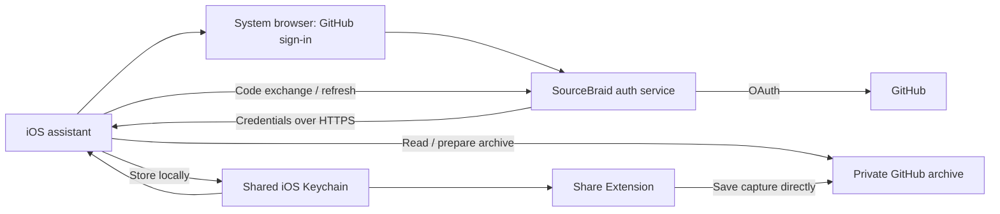

# SourceBraid: Installer plan for iOS and iPadOS after version 1.1.0

**SourceBraid — Weave the web into Markdown.**

As of: **October 15, 2026 · Revision 2** · Baseline: **iOS/iPadOS 1.1.0, build 11**
· Status: **New implementation plan; installer not yet implemented**
· [Deutsche Version](IOS_ONBOARDING_INSTALLER_PLAN.de.md)

This revision replaces the October 12 draft. The maintainer has confirmed
the App Store release of 1.1.0. The reviewed source baseline is tag
`ios-v1.1.0`, commit `e55f1fc17483096c4c05286713d6725b951d4d06`, compared
with `bb7c77a`. This plan does not preselect a version number for the next
installer release.

## 1. Recommendation and goal

**The released iPhone/iPad app becomes the main setup route.** The
“installer” is primarily a guided setup assistant inside the app. It connects
GitHub, creates a private archive or connects an existing one, checks that it
can be used, and guides the user to their first saved clip. Chrome and
ChatGPT/Codex are then offered as optional additions.

The goal for new users is: **Install the app → sign in to GitHub → confirm a
private archive → save the first item.** Nobody needs to understand Git,
branches, Personal Access Tokens, or a terminal to do this. A GitHub account,
sign-in, and explicit authorizations remain necessary; SourceBraid does not
automate account verification or two-factor authentication.

Recommended technical direction:

- A **GitHub App** registered by the maintainer, which users authorize for
  their archive. Users do not create their own developer app.
- Browser sign-in from iOS with PKCE and a small SourceBraid service for
  securely exchanging and renewing credentials.
- Direct capture transfers between iOS and GitHub. Markdown and Git history
  remain authoritative; local databases are rebuildable caches.
- Automatic creation of a private archive after an early technical proof of
  feasibility; a guided GitHub form remains a simpler first stage.
- Existing PAT configurations continue to work. Manual entry moves to
  “Advanced setup.”

The reader, search, chat interface, and refresh functionality from 1.1.0 are
reused. The installer adds their entry flow and connection management. An
update must not force existing users through mandatory setup again.

This document plans the work. It does not register a GitHub App, operate a new
service, or change existing privacy commitments. The
[release notes](IOS_RELEASE_1.1.0.md),
[reader plan](IOS_READER_INTELLIGENCE_DUO_PLAN.md), and
[outstanding device checks](IOS_DEVICE_ACCEPTANCE.md) remain references for
the existing feature set.

## 2. Current repository state

### Release boundaries and changes since the previous plan

The iOS runtime sources match `ios-v1.1.0`. The release contains 58 changed
files compared with its predecessor. The new foundation available for reuse
includes:

- “Latest” with seven clips, the Markdown reader, and local full-text search.
- Startup from the cache without downloading all text again; an empty cache
  initially loads at most seven article bodies. Search coverage may explicitly
  be partial.
- Bounded background refresh plus cancellation and cache coordination.
- Adaptive iPhone/iPad navigation, optional local chat, and read-only Shortcuts.
  Apple Intelligence remains independent of setup.

The Share Extension already existed. GitHub sign-in, repository creation,
and token renewal were **not** added in 1.1.0.

App Store publication: confirmed by the maintainer. Source version: checked
through the Git tag, version fields, and a local build. This does not establish
an independent check of the binary distributed through the store. In the iOS
tag, Chrome, Codex, and MCP are still at 1.0.1. The follow-up work committed
separately during the review in `467542a` prepares these components for 1.1.0;
the iOS runtime sources remain unchanged from the iOS tag. This additional
commit does not demonstrate public plugin availability. This plan does not
change that follow-up work.

| Area | Available today | Missing for simple setup |
| --- | --- | --- |
| [iOS settings](../ios/SourceBraid/App/SettingsView.swift), [ViewModel](../ios/SourceBraid/App/SettingsViewModel.swift) | Form for owner, repository, branch, archive folder, and token | Guided sign-in, archive selection, creation, understandable states |
| [GitHubClient](../ios/SourceBraid/Shared/GitHubClient.swift) | Repository query, capture writes | Complete checks for branch, privacy, write capability, and PDF support |
| [Configuration](../ios/SourceBraid/Shared/SourceBraidConfiguration.swift), [Keychain](../ios/SourceBraid/Shared/KeychainStore.swift) | Shared settings and one token for app/Share Extension | Authentication type, expiry, refresh, account binding, and safe migration |
| [Reader](../ios/SourceBraid/Archive/ArchiveLibrary.swift) | Released reading, search, cache startup, and latest seven | Handle a new empty archive correctly; explicitly read back the first capture |
| [Background refresh](../ios/SourceBraid/Archive/ArchiveBackgroundRefresh.swift) | Bounded requests and coordinated cache writes | Respect connection state across restarts; integrate renewable credentials |
| [Shortcuts](../ios/SourceBraid/Archive/ArchiveIntents.swift) | Search and open already downloaded entries | Adopt the new credential model while preserving local identities and offline behavior |
| [Setup script](../scripts/setup_github.py), [package builder](../scripts/build_setup_package.py) | Private repository, support files, and configuration without a token | Python and an authenticated `gh` are required; manual PAT creation remains the final step |
| [Chrome extension](../chrome-extension/sourcebraid/popup.js) | Manual settings, capture, and plugin configuration export without a token | Sign-in and import of a configuration prepared by iOS |
| [Hosted ChatGPT](../chatgpt-mcp/src/auth.mjs) | Prepared OAuth service with per-user grants | GitHub sign-in instead of a separate PAT; deployment and public release approval |
| [Local Codex plugin](../codex-plugin/sourcebraid/scripts/sourcebraid.py) | Python standard library, local search, existing GitHub credentials | Optional simpler configuration import; not part of basic iOS setup |

### Specific implementation findings

1. “Test connection” currently saves the new configuration before checking the
   network. A failed attempt can therefore switch the existing archive and
   remove its local cache. The assistant needs a draft that becomes active
   only after successful validation.
2. The current connection check reads only repository metadata. This proves
   neither that a branch exists nor that a capture succeeds. “Connected,”
   “Reading available,” and “Saving verified” must become separate states.
3. Fields and Save remain usable during the check. After the network call,
   the success message uses the inputs that are current at that time. It can
   therefore name a different repository from the one tested. An immutable
   draft with a revision check must keep request, result, and activation together.
4. A missing archive folder still produces a 404 error. The new empty list
   does not repair this. Bootstrap and the true “no clips yet” state must be
   distinguished from missing access or an incorrect branch.
5. Returning to the app after a capture restores an existing cache without
   automatically loading a new GitHub snapshot. The assistant must explicitly
   fetch the first capture; waiting for background refresh is not a reliable
   way to complete setup.
6. The block on background requests after sign-out currently exists only in
   memory. Saved repository fields remain; after a restart, scheduling can
   resume even though the token was removed. Persistent connection state must
   constrain scheduling and execution.

These findings are in `SettingsViewModel.testConnection`,
`GitHubClient.testConnection`, `ArchiveReadClient.snapshot`,
`ArchiveLibrary.configure`, and `ArchiveBackgroundRefresh.schedule`.
They are findings of this plan’s review and were not fixed in product code here.

### Evidence from this review

- Source validator: **passed for 1.1.0/build 11**.
- Unsigned generic simulator build with **Xcode 27.1 / 27A9275 passed**;
  the generated app bundle also passes the validator.
- The current iPad test run and its limitations are recorded in section 12.
- Earlier figures in the [release record](IOS_RELEASE_1.1.0.md) remain
  historical evidence. They are not presented as tests rerun for this review.

The setup script is a good reference for allowed files and repeatability.
However, its blanket enabling of GitHub Actions with `allowed_actions: all`
should **not** be carried into the new assistant.

## 3. What the installer should do

### Required scope of the first user-friendly version

- Get started without a terminal, Python, or GitHub CLI.
- Explain in everyday language: “Your archive is a private folder on GitHub.
  The files belong to you and remain usable independently of SourceBraid.”
- GitHub sign-in, understandable repository authorization, and account display.
- Create a new private archive or connect an existing archive.
- Detect technical fields automatically; show them under “Advanced” only when
  needed.
- Initialize, resume after interruption, and validate with specific recovery
  actions when errors occur.
- Introduce iOS sharing and guide the first real capture, including reading it
  back.
- Provide a “Connections” area that remains accessible for renewal and repair.
- Complete German and English text, VoiceOver, and Dynamic Type.
- Take existing users directly to the reader; offer PAT migration as optional.
- Allow complete setup on an iPad without prior iPhone setup.
- Connect the existing archive on a second device instead of creating a
  duplicate. Each installation signs in to GitHub independently.

### Deliberately deferred

PDF conversion, Chrome connection, hosted ChatGPT, and local Codex setup must
not block a successful basic start. Apple Intelligence is not required either.
A separate desktop installer is initially a lower priority; the existing
script remains available for technical users and as an independent route
without an iPhone. Android remains on the roadmap.

## 4. Sign-in: options and decision

| Option | Benefit | Effort and limitation | Role |
| --- | --- | --- | --- |
| Guided fine-grained PAT | Small change; existing clients remain compatible | The token still needs to be created, copied, and later replaced | Transition and expert route |
| GitHub App, browser flow + PKCE + auth service | Understandable sign-in; targeted repository authorization; automatic renewal | Operating a small service and new credential handling | Recommended product goal |
| GitHub App, device flow | No app secret in the client; no dedicated token exchange service required | Code entry, polling, and increased phishing exposure | Evaluate as a justified alternative, not the iOS default |
| OAuth App | Familiar sign-in route | Private repositories typically require broad `repo` access | Lower priority than a GitHub App |
| Desktop script with `gh auth login` | Much is already available | Additional installation and terminal knowledge | Addition for advanced users |

For comparison of the breadth of OAuth App access:
[GitHub: OAuth scopes](https://docs.github.com/en/apps/oauth-apps/building-oauth-apps/scopes-for-oauth-apps).

GitHub documents PKCE in the web flow but still requires a `client_secret`
during code exchange. The plan therefore does not promise a purely native web
flow without a secret. The auth service is our architecture decision for
keeping that secret on the server.
[GitHub: User access token flow](https://docs.github.com/en/apps/creating-github-apps/authenticating-with-a-github-app/generating-a-user-access-token-for-a-github-app#using-the-web-application-flow-to-generate-a-user-access-token)

GitHub prefers PKCE over device flow and recommends the latter only where a
justified need exists in constrained environments. A client secret embedded
in a native app would not be confidential either. Device flow therefore does
not become the default solely to save server work.
[GitHub: Best practices](https://docs.github.com/en/apps/creating-github-apps/about-creating-github-apps/best-practices-for-creating-a-github-app#client-secrets)

For the existing PAT route, a GitHub link can prefill the name, owner, expiry,
and Contents permission. The user must check that the single archive repository
is selected; the link does not create a token automatically. Tokens belong
only in the protected input field, never in a chat, QR code, support ticket,
or configuration export.
[GitHub: PAT templates](https://docs.github.com/en/authentication/keeping-your-account-and-data-secure/managing-your-personal-access-tokens#pre-filling-fine-grained-personal-access-token-details-using-url-parameters)

## 5. The user journey

| Step | Display and action | What SourceBraid handles |
| --- | --- | --- |
| 1. Welcome | “Your own knowledge archive”; “Set up” | Brief explanation of GitHub and private ownership; existing users skip this step |
| 2. Connect GitHub | “Connect to GitHub”; alternatively “Create a GitHub account” | Browser sign-in, return, and verification of the signed-in account |
| 3. Choose archive | “New private archive” or “Existing archive” | Suggest `sourcebraid-archive`, check for name collisions, and offer existing choices |
| 4. Confirm access | GitHub displays SourceBraid and the repositories to authorize | Guide selection of exactly the archive; verify the actual installation afterward |
| 5. Prepare archive | “Preparing archive” with named substeps | Determine the branch, initialize the archive folder with `.gitkeep`, preserve existing files |
| 6. First save | Short guide for Safari → Share → SourceBraid | Save an actual capture, explicitly fetch it, and open it in the existing reader |
| 7. Done | “Your archive is ready” | Optionally connect PDF, Chrome, or ChatGPT; all can be skipped |

The order of archive creation and installation authorization depends on the
chosen bootstrap method; the interface shows only the next step needed at
that point. Signing in to GitHub and installing the GitHub App are separate
authorizations. Successful sign-in alone does not establish archive access.

Defaults apply only to new archives. Existing names, folders, and branches are
not renamed. In particular, the actual default branch is detected instead of
assuming `main` everywhere. The previous name `sourcebraid-private` is no proof
of privacy and must not be confused with the maintainer’s private authoring
repository.

No test silently creates an apparently real article. An optional synthetic
setup file must be announced as such. A capture initiated by the user with
correct provenance is the strongest evidence for successful completion.
Read-only access remains a usable mode with the message “Authorization to
save is missing.”

### Entry points for new and existing installations

| Starting point | Entry flow | Success |
| --- | --- | --- |
| New iPhone or iPad without configuration | Assistant replaces “Connect your archive → Settings” and the empty reader placeholder | Private archive connected; first capture retrievable |
| Update of a working 1.1.0 installation | Directly to “Recent,” with an optional notice in “Connections” | Existing archive and cache remain usable |
| Second device / reinstallation | Prominently offer “Connect existing archive” | Select the same repository and receive separate credentials |
| Expired or revoked credential | Repair the connection instead of creating a new archive | Confirm identity and renew access |
| Read-only permissions | Reader and search with clear labeling | Reading usable independently of capture |

The existing synthetic demo is a debug/test mode, not a released customer
feature. A public preview would be separate work and is not required for
this installer.

### iPhone and iPadOS

A shared `OnboardingCoordinator` controls the same functional flow. On iPhone
and in narrow iPad windows, one step is displayed at a time; a wide iPad
window can show progress and explanation alongside the current form.
Navigation state, scroll position, and inputs survive rotation, resizing,
and return from the browser. No fixed screen widths or fullscreen requirement.

Keyboard input, Tab navigation, visible focus, VoiceOver, large text, and
portrait/landscape orientations are part of acceptance. Existing adaptive
navigation is reused; an iPad is not tested merely as an enlarged iPhone.

`WindowGroup` alone does not prove support for multiple simultaneously usable
app windows, and this is not an implicit new release promise. O00 checks scene
configuration and actual window support. The connection coordinator permits
at most one active sign-in/activation across the app. Other supported windows
show the operation instead of starting another. Late results from a closed
or superseded assistant must not overwrite a newer connection.

## 6. Technical architecture for iOS and iPadOS

Apple provides `ASWebAuthenticationSession` as a system mechanism for web
sign-in. We use it instead of a custom password form or the capture WebView.
Implementation preserves the existing iOS 17 support and checks callback API
availability.
[Apple: ASWebAuthenticationSession](https://developer.apple.com/documentation/authenticationservices/aswebauthenticationsession)

The presentation anchor comes from the window that initiated sign-in. The
session and presentation delegate are retained until completion; do not use
a global “first window” from all scenes. A startup failure or cancellation
returns to the existing draft.
[Apple: Web sign-in](https://developer.apple.com/documentation/authenticationservices/authenticating-a-user-through-a-web-service)

The newer HTTPS callback requires iOS/iPadOS 17.4 and an associated domain.
For the still-supported OS versions 17.0–17.3, a tested older custom-scheme
callback with PKCE and state binding is required. Callback APIs and
Associated Domains are new configuration, not part of 1.1.0. Raising the
minimum version is not planned here.
[Apple: Callback API](https://developer.apple.com/documentation/authenticationservices/aswebauthenticationsession/callback)



### Responsibilities of the auth service

The service keeps the client secret in a protected server environment and
supports sign-in and refresh. It does not proxy archive files and, in the
basic model, does not need a GitHub App private key to mint installation
tokens. iOS uses GitHub App user access tokens.

Planned contract:

1. iOS starts a short-lived sign-in with random `state` and PKCE S256.
2. The service binds the transaction to the initiating app session and an
   exactly allowlisted callback address; no arbitrary redirect destinations
   supplied by callers.
3. GitHub authenticates the user. On return, state, expiry, and the binding
   to the original request are checked.
4. A one-time return code is redeemed from the app over HTTPS. The verifier
   and code exchange must belong to the same PKCE transaction. GitHub tokens
   must not enter callback URLs or browser histories.
5. The service exchanges the GitHub code using the server-side secret and
   delivers the tokens only to the initiating app. The app checks GitHub
   identity and archive access before activation.
6. Token renewal uses a protected endpoint bound to the session. It must not
   be an open token proxy or arbitrary HTTP proxy.

The broker session proof must remain verifiable after the app restarts and
the GitHub access token expires. O00 defines its secure storage, binding to
the authorized connection, lifetime, renewal, and revocation. An ordinary
refresh should not require another browser sign-in; an expired or revoked
broker session may require one.

This is an interface draft to be reviewed, not a newly invented OAuth
protocol. A maintained OAuth implementation and a security review must cover
replay, login CSRF, app impersonation, and failed handoffs.

**Privacy impact:** The service processes tokens at least transiently and
therefore cannot be advertised as having “no access to credentials.” The
proposal calls for no persistent token storage for iOS, no content database,
and no logging of tokens, codes, or request bodies. Short-lived session data,
operational metadata, retention periods, hosting, and secret rotation must be
defined before release. The existing Cloudflare infrastructure is a possible
hosting route, not an already available native sign-in solution.

### A consistent connection instead of a single token string

The new connection receives a stable local ID and a revision. A
`CredentialProvider` supplies credentials together with their associated
GitHub/archive identity. Settings, reader, and extension must not combine
a new owner and an old token read at different times.

Keychain and App Group defaults do not form a shared database transaction.
A new credential version is therefore first prepared and checked separately,
then activated through a coordinated update of an active reference. Partially
written states must be detected after process termination; the last valid
connection remains active until successful activation. A concrete
commit/recovery contract belongs in O01.

The same archive with renewed credentials retains its cache and Shortcut IDs.
An explicit archive switch uses the existing invalidation and cache cleanup
only after successful activation. All running operations check their
connection revision before applying a result. During a switch, a capture
already in progress is completed or cancelled in a controlled way, never
retried against the newly selected repository.

### Lifecycle of all credential consumers

The shared Keychain receives a versioned credential model with authentication
type, stable GitHub user ID, app/installation association, access and refresh
tokens, and expiry times. Nonsecret archive configuration remains separate.
Existing Keychain and App Group identities are preserved.

| Consumer in 1.1.0 | Adaptation for renewable credentials |
| --- | --- |
| `SettingsViewModel` and assistant | Validate an immutable draft; activate only the same revision |
| `ArchiveLibrary` / `ArchiveReadClient` | Obtain credentials before requests; switch tokens within the same archive without deleting the cache |
| `ArchiveBackgroundRefresh` | Schedule only with a persistently authorized connection; bounded refresh or clean cancellation, no login dialog |
| `GitHubClient` / `ShareViewModel` | Load matching configuration and credentials; detect switches during image fetching/upload |
| `ArchiveIntents` | Preserve local device authentication and cache access; no interactive sign-in or repository creation from Shortcuts |

The existing `ArchiveRefreshCoordinator` protects cache writes within the app
process. It does not replace a cross-process token lock shared with the Share
Extension. The new credential model must connect both coordination layers
without removing existing cancellation and deletion safeguards.

GitHub documents defaults of eight hours for user access tokens and six
months for refresh tokens; a successful refresh invalidates the old pair.
The implementation uses the returned expiry values and checks the app
configuration that is actually enabled.
[GitHub: Refresh](https://docs.github.com/en/apps/creating-github-apps/authenticating-with-a-github-app/refreshing-user-access-tokens)

The app and Share Extension must not consume the same refresh token
concurrently. Cross-process coordination, rereading after acquiring the lock,
and atomic replacement of the credential set are required. A refresh timeout
must not trigger a blind retry loop; if the new token pair is lost, signing
in again is an intended recovery route. The extension has a short execution
window: when necessary, clearly direct users to “Open SourceBraid and renew
the connection.” A failed upload must never be reported as saved.

The existing Keychain item is not synchronizable and is bound to the device.
A newly configured iPad therefore does not inherit an iPhone token. The
default remains: sign in on the second device and select the same archive.
Authentication secrets belong neither in `SceneStorage` nor in configuration
files. Only nonsecret steps and inputs are stored there or in assistant state
restoration. Persistent credentials and broker session proofs remain in the
Keychain; sign-in attempts that have not been securely saved restart after
process loss.
[Apple: Device-bound Keychain](https://developer.apple.com/documentation/security/ksecattraccessibleafterfirstunlockthisdeviceonly)

Sign-out and revocation invalidate pending login/refresh results. A token
arriving afterward must not reactivate the connection. A persistently stored
`signedOut` state blocks background jobs even after app restart. “Offline
with a valid local connection” and “signed out” remain different states;
readable cache must not disappear on every network error.

In particular, the local connection remains usable for offline reading and
search when only the short-lived access token has expired and the auth service
is unreachable. Network token validity and local access authorization are
separate conditions. Explicit sign-out or removal of local data retains its
existing effect; a failed refresh does not delete the cache.

## 7. Archive creation and permissions

### A. Smallest releasable route

The assistant opens a prepared GitHub form for a private repository. It then
guides installation of the GitHub App with the archive selected. Afterward,
it uses the API to check repository ID, owner, private status, and actual
access; form values and return parameters are not trustworthy confirmation.

Example of the documented form route:
[Prepare a private archive on GitHub](https://github.com/new?name=sourcebraid-archive&visibility=private&owner=%40me).
[GitHub: Repository form parameters](https://docs.github.com/en/repositories/creating-and-managing-repositories/creating-a-new-repository#creating-a-new-repository-from-a-url-query)

### B. Preferred convenience goal: creation directly from the app

The current GitHub documentation lists **Repository creation** as a narrower
permission than Administration and describes automatic access to repositories
the app creates. This makes direct creation feasible in principle.
[GitHub: Choosing permissions](https://docs.github.com/en/apps/creating-github-apps/registering-a-github-app/choosing-permissions-for-a-github-app)

After installation/authorization, iOS calls `POST /user/repos`, explicitly
with `private: true`. The response provides the repository ID to verify.
Access is then checked again through the installation, and the archive is
initialized. The public API default must never be used accidentally.
[GitHub: Create a repository](https://docs.github.com/en/rest/repos/repos?apiVersion=2026-03-10#create-a-repository-for-the-authenticated-user)

**Early proof O00:** a fresh account without a repository, actual availability
of the creation permission, installation with zero/selected repositories,
automatic access, an existing installation with a declined permission
upgrade, name collision, and a timeout immediately after creation. This
sequence has not been exercised in practice for this plan. If the proof
fails, implement route A first. Do not fall back broadly to administration
permissions or all repositories.

### Target permission model

| Function | Planned access | Boundary |
| --- | --- | --- |
| Reading | Read Metadata and Contents | Independent read-only mode |
| Capture | Write Contents in the selected archive | No general repository administration permissions |
| New archive | Separately justified Repository creation permission for route B | Route A needs no authority to create repositories |
| PDF setup | Write Contents and Workflows for the support files | Separate setup step, not a default capture permission |
| PDF status | Read Actions only if necessary | No automatic changes to organization policies |
| Hosted ChatGPT | Its own GitHub connection limited to reading | No forwarding of the iOS write token |

The specific API endpoints and permissions will be verified in O00 with
minimal test accounts, particularly
[Contents write access](https://docs.github.com/en/rest/repos/contents#create-or-update-file-contents)
for normal files and workflow files. GitHub App permissions are tied to the
registration and are not freely switchable OAuth scopes. An optional PDF
toggle does not retroactively make a globally requested workflow permission
optional. For the first version, PDF setup uses a separate, narrowly scoped
setup route; a separate setup app may follow later. Each additional app
increases usability complexity and must provide a demonstrable benefit.

Likewise, “Read only” in the interface does not reduce an already granted
GitHub permission. Existing Contents-read PATs remain supported for this mode.
The capture GitHub App requests Contents write permission; guaranteed
read-only OAuth sign-in needs a correspondingly separate permission
registration and is not promised as an already solved property of capture
sign-in.

Existing archives are connected only after selection. Personal accounts are
the first fully supported setup route; organizations, SSO, and pending admin
approvals receive their own states. Rules and branch protection are not
disabled to force a capture through.

## 8. Initialization and PDF conversion

### First capture in the released reader

1. Create the new archive with an initial commit and `.gitkeep`; explicitly
   display the empty state. A 404 caused by missing authorization remains an error.
2. Have the user save a public example of their choice or their own authorized
   content through the actual Share Extension.
3. Associate the successful capture with archive identity, path, and available
   commit/file evidence; no additional token in the return notification.
4. On return, explicitly read the saved path or perform a bounded refresh of
   the archive snapshot. Current cache-only startup is insufficient here.
5. Open the clip in the existing reader and set “Saving verified.” A failed
   read leaves the step incomplete without immediately repeating the upload
   and creating duplicate captures.

The assistant waits neither for a complete search index nor for an
OS-scheduled background job. The seven-body initial download limit remains;
targeted capture verification has a separate limit. For large existing
archives, setup must not trigger a full download. “Archive connected,”
“Saving verified,” and “Search coverage” are independent indicators.

### Repeatable bootstrap

Bootstrap receives an explicit file list and becomes repeatable:

- Prepare a new archive with an initial commit and `<archive-folder>/.gitkeep`.
  Git does not store empty directories. An archive without captures then
  becomes a valid state; an archive folder that has not yet been created
  must also be handled clearly during first setup.
- Create only planned files. Compare and preserve existing files; show
  conflicts. Do not overwrite for convenience.
- After an ambiguous network response, check remotely first whether the step
  has already completed. No second repository or duplicate test capture.
- Document setup steps and remaining work without secrets. Cancellation does
  not delete a repository that has already been created.
- Preserve capture paths, YAML frontmatter, and URL-hash index shard formats.
  A new configuration schema requires explicit versioning and migration.

PDF remains a separate step, “Automatically convert PDFs to Markdown.”
Reuse the existing allowlist:

```text
.github/workflows/convert-pdfs.yml
requirements-docling.txt
scripts/convert_pdfs.py
scripts/push_with_retry.py
```

The files come from the verified public project sources and are bundled with
a pinned version. Neither `website/` nor a private `web-clips/`, local
configuration, or Git history is copied. The private authoring repository is
not forked or exported either.

The PDF step explains processing through GitHub Actions and possible
quotas/costs, without promising unlimited free operation. A synthetic PDF
checks the actual end-to-end run. “PDF uploaded,” “Conversion pending,” and
“Markdown available” remain separate. When Actions are disabled, normal
saving, reading, and search remain usable; pending PDF conversion is visible
rather than reported as complete.

## 9. Connect Chrome, ChatGPT, and Codex as additions

### Chrome

The existing share button in the reader exports Markdown content. Exporting
repository settings from iOS remains a planned new feature.

After basic iOS setup, the app can provide a configuration without credentials.
Existing keys remain compatible:

```json
{
  "owner": "example-user",
  "repo": "sourcebraid-archive",
  "branch": "main",
  "root_folder": "web-clips"
}
```

This is a synthetic example, not a real configuration. Chrome first needs
an import dialog with a preview, strict path validation, and its own GitHub
sign-in. Imported values do not grant access. OAuth callbacks, Manifest V3
service worker restarts, and any necessary new browser permissions receive
targeted checks. No iOS tokens, cookies, or refresh tokens are transferred to
the extension.

Later QR code pairing may contain only configuration or a short-lived,
one-time pairing proof bound to the session. Repository names must also be
treated as private. Installation and authorization of the Chrome extension
take place in the browser; the iOS app can guide them but cannot silently
install the extension.

### Hosted ChatGPT

The [prepared MCP integration](CHATGPT_MCP_DEPLOYMENT.md) already has per-user
OAuth grants. However, its OAuth connects **ChatGPT to SourceBraid**. The
consent page still requests a separate GitHub PAT. This sign-in does not yet
solve the GitHub token problem.

Expansion requires an independent read-only GitHub connection, preferably a
separate GitHub App registration without write permissions. Consent and the
association with a user, installation, and exactly one archive are checked
on the server. The existing code explicitly accepts `github_pat_` and
determines identity through `/user`; installation tokens are therefore not
an interchangeable substitute. Credential type, authorization, and renewal
must be deliberately adapted and tested with two separate test accounts.

Between ChatGPT and MCP, a dedicated OAuth flow with PKCE, resource binding,
and token validation remains necessary. A GitHub token is not an MCP access
token.
[OpenAI: Plugin authentication](https://developers.openai.com/plugins/build/auth)

This hosted route processes requested content at SourceBraid/Cloudflare and
OpenAI. It receives its own consent and privacy description. The iPhone does
not become a permanently reachable MCP server. The connection must work
independently of a running iPhone. Public availability is announced only
after deployment, testing, and approval; before that, the app does not show
a connection button that appears to work.

### Local Codex plugin

The existing route with a local Python runtime and GitHub access remains
available. Configuration from iOS can simplify it later. The standard library
remains sufficient; this plan requires no new Python package. Reading and
confirmed write/delete actions retain separate requirements. No ChatGPT or
Codex account is required for basic iOS features.

## 10. States, errors, and recovery

The assistant stores a draft separately from the active configuration.
One possible sequence is:

```text
unconfigured → authenticating → choosingArchive → authorizingArchive
→ provisioning → readReady → captureVerified → completed
```

`cancelled`, `offline`, `authorizationPending`, `reauthRequired`, and
`repairRequired` are resumable states. PDF and additional integrations are
separate capabilities, not required states in this sequence.

`readReady` is an independently usable endpoint for read-only operation.
`captureVerified` requires actual evidence of writing and reading back.
“Setup complete” is therefore always stored together with the selected
read-only or capture mode; incomplete search coverage blocks neither.

### Migration from 1.1.0

1. Read the legacy configuration and existing PAT without rewriting them.
   Working installations continue to open in the reader.
2. In “Connections,” optionally offer “Set up GitHub sign-in”; carry over
   owner, repository, branch, and root from the existing connection.
3. Check new sign-in and archive access in the separate draft. Cancellation
   preserves the old PAT and the complete previous connection state.
4. Activate the successful connection once, with recovery support; switch all
   consumers to the same revision. Within the same archive, preserve the cache
   and `cacheKey:path` Shortcut identities.
5. Remove the old PAT locally only after activation is secure. Explain GitHub
   revocation separately, as the PAT may still be used in Chrome.
6. If errors occur later, repair the new connection first. No silent fallback
   to an already revoked PAT and no creation of a new archive.

| Situation | User guidance / required behavior |
| --- | --- |
| Sign-in cancelled | Return to the previous page; existing connection remains active |
| Wrong GitHub account | Display the account clearly and offer an explicit account switch |
| 401 / revoked token | Renew once where appropriate or sign in again; no infinite loop |
| 403 / missing permission | Identify the missing authorization; distinguish organization approval from rate limits |
| 404 | Distinguish missing visibility, wrong repository, missing branch, and empty archive |
| Public repository | Require a private alternative in the beginner route; do not automatically change an existing repository |
| Name taken | Check an existing archive or suggest another name; overwrite nothing |
| Protected branch | Explain the block; explicitly choose an allowed branch while preserving protection |
| Interruption after creation | Find the existing repository and continue; no automatic deletion |
| Offline / rate limit | Preserve progress, retry with backoff, keep existing cache usable |
| New device / reinstalled app | Sign in again and select the existing archive; no duplicate creation |
| Share Extension without valid access | Clear error message and repair in the main app |

“Sign out on this device,” “Revoke GitHub authorization,” “Remove local data,”
and “Delete repository” are different actions. The assistant does not delete
archives. Revoking GitHub App authorization can affect other devices;
independent revocation per device is not promised without verification.
[GitHub: Revoke authorization](https://docs.github.com/en/apps/using-github-apps/reviewing-and-revoking-authorization-of-github-apps)

## 11. Implementation packages and order

Estimates are person-days for development and testing, not commitments.
App Store review, operator approvals, and waiting times are excluded.

| Package | Work and affected areas | Outcome / acceptance | Rough size |
| --- | --- | --- | --- |
| O00 – Feasibility after 1.1.0 | Test GitHub App, web flow/PKCE/refresh, creation permission, callbacks from OS 17 onward, and iPad scene configuration | Written API/permission evidence, decision between archive routes A and B, and hosting contract | 2–3 days |
| O01 – Connection and migration | Immutable draft, revision-based activation, CredentialProvider for all consumers, legacy PAT migration, persistent signed-out state | Old connection survives errors; late results and background jobs do not reactivate it | 4–6 days |
| O02 – Sign-in | Auth service, AuthenticationServices, window-bound callbacks, cross-process refresh | Login/cancellation/refresh/revocation, including restart and negative security tests | 5–8 days |
| O03 – Archive | Repository selection/creation, branch detection, idempotent bootstrap, empty reader | Fresh private archive and existing archive successfully verified | 3–5 days |
| O04 – Assistant on iPhone and iPad | First-run entry, update/second-device route, narrow/wide windows, actual Share Extension, targeted capture readback | iPhone and iPad independently reach their first capture; existing reader is preserved | 4–6 days |
| O05 – Release acceptance | DE/EN, accessibility, migration, privacy text, operations, and device checks | First version ready for approval without mandatory additional integrations | 3–5 days |
| O06 – PDF | Separate permission/setup route and conversion status | Complete synthetic PDF conversion; normal archive usable independently | Estimate separately afterward |
| O07 – Chrome | Configuration import, own sign-in, optional pairing later | Same archive usable, no token forwarding | Estimate separately afterward |
| O08 – ChatGPT/Codex | Read-only GitHub connection for the MCP service, local import | Separate permissions and working account isolation | Estimate separately afterward |

O00–O05 total approximately **21–33 person-days**. The higher range compared
with the previous draft accounts for migration of released installations,
background consumers, iPad windows, and targeted capture readback. O00 may
change this estimate.

O00 and the locally testable parts of O01 can be prepared in parallel. O02
builds on their connection contract, and O03 on verified authentication.
O04 connects these components; O05 accepts the first complete version. PDF
and additional integrations follow independently.

A guided PAT route remains available but is not a mandatory new intermediate
release. A small early fix for “Test connection” could be released separately.
It does not yet meet the goal of “no manual token creation” and does not
replace the installer.

Proposed new iOS components: `OnboardingCoordinator`,
`GitHubAuthorizationClient`, `GitHubRepositorySetupClient`, and
`CredentialProvider`. These names are drafts, not existing files.
Capture code remains focused on its existing format.

| Existing area | Planned change |
| --- | --- |
| `ContentView.swift`, `SettingsView.swift` | First-run entry and connections; preserve existing reader/tab navigation |
| `SettingsViewModel.swift`, `SourceBraidConfiguration.swift` | Draft, legacy decoding, immutable test request, and revision-based activation |
| `KeychainStore.swift`, App Group | Versioned credentials and cross-process coordination; preserve identities |
| `GitHubClient.swift`, `ArchiveReadClient.swift` | CredentialProvider and targeted connection/capability checks |
| `ArchiveLibrary.swift`, `ArchiveBackgroundRefresh.swift`, `ArchiveIntents.swift` | Preserve existing cache/cancellation mechanisms; integrate lifecycle and readiness |
| `ShareViewModel.swift` | Consistent connection, refresh limit, and capture evidence |
| `Info.plist`, entitlements, project, localized text | Callback/domain configuration, availability, new screens, and DE/EN |
| New auth service | Its own sources, tests, and public release allowlist; do not export the private website |

## 12. Tests and mandatory acceptance criteria

### Checks rerun on October 15, 2026

| Check | Result of this review |
| --- | --- |
| `python3 scripts/validate_ios_release.py` | Passed, 1.1.0/build 11 |
| Generic simulator build, app and extension, without signing | Passed with Xcode 27.1 (27A9275) |
| Validator on the generated simulator app bundle | Passed, 1.1.0/build 11 |
| Existing unit/integration tests on iPad Pro 13-inch (M5), runtime 27.0 | **47 passed, 0 failures** |
| Existing UI suite on the same iPad simulator | **7 passed, 0 failures** |

Build and tests used the tag’s iOS sources, dedicated Derived Data under
`/private/tmp/sourcebraid-installer-review-20261015-derived`, and serial
simulator execution. Test evidence:
`/private/tmp/sourcebraid-installer-review-20261015-ipad.xcresult`, plus
`sourcebraid-installer-review-20261015-ipad.log` and
`sourcebraid-installer-review-20261015-build.log` in the same temporary directory.
These artifacts remain outside the repository. Xcode could access the simulator
and package cache only outside the sandbox; the first blocked attempt is not
a product failure.

The UI suite uses synthetic debug data. It does not prove real GitHub sign-in,
first-time Share Extension setup, narrow iPad windows, multiple active windows,
or minimum-OS functionality. Physical devices and an actual App Store binary
comparison were not tested in this review. Node/Python core suites and MCP
tests were not rerun for this documentation-only change. Previous release
evidence remains separate.

### Automated

- State transitions, draft/activation, cancellation, and migration of old settings.
- PKCE, incorrect `state`, foreign callback URL, replay, expired session,
  lost token response, and concurrent refresh from app/extension.
- User/repository/installation binding, foreign repository ID, and two
  separate accounts; no access through manipulated configuration imports.
- New/missing branches, empty archive, existing files, name collision,
  timeout after commit, and repeated bootstrap.
- Read-only access, denied writes, branch protection, PDF without a workflow.
- No secrets in logs, diagnostic exports, URLs, packages, or screenshots.
- Change inputs during a running connection check: result and activation must
  remain tied to the tested draft; discard outdated results.
- Process termination between credential preparation and activation: after
  restart, either the complete old or complete new connection, never a mixture.
- Sign out → quit app → restart: no new background requests without an active
  connection. Late refresh responses must not undo sign-out.
- PAT → GitHub App within the same archive: preserve cache, downloaded clips,
  and Shortcut identities; no full reindexing required for setup.
- Access token expired and device offline: downloaded clips and local search
  remain usable without a network refresh; new network actions show the required
  reconnection state. Explicit sign-out remains separate.
- Empty initialized archive → capture → return: the clip appears through a
  targeted fetch even without a background run or manual refresh workaround.

### On physical devices and with GitHub test accounts

- Fresh account without a repository through to the first capture; connect
  an existing archive without overwriting it.
- Existing PAT users migrate only after successful new sign-in.
- Sign-in with two-factor authentication, cancellation, and the wrong account.
- App backgrounding, interrupted connection, token expiry, revocation,
  reinstallation, and Keychain access before the first unlock.
- Safari sharing, other share sources, iPhone/iPad, VoiceOver, large text,
  German and English, and the oldest supported iOS version.
- iPad fullscreen and in narrow/wide windows, resizing during sign-in,
  hardware keyboard and focus, browser return to the initiating window.
- If multiple app windows are approved: second sign-in attempt, closing a
  window, confirming an outdated assistant, and sign-out during refresh.
  Without multiwindow approval, do not advertise this capability as tested.
- Check callbacks separately on OS 17.0–17.3 and 17.4+. Testing on runtime
  27.0 does not replace this availability check.
- iPhone first / iPad second and iPad first / iPhone second: same archive,
  independent sign-in, and no accidental creation of a second repository.
- Five people without GitHub experience test the flow. Target: at least four
  complete their first capture without personal assistance; setup time and
  abandonment points are observed with consent. This is a proposed product
  goal, not a measured result or a new telemetry requirement.

### Repository checks during later implementation

For shared capture, script, or plugin changes, run both core suites from the
repository root:

```bash
node --test tests/capture-utils.test.js
python3 -m unittest discover -s tests -p "test_*.py"
```

Build iOS from `ios/` without signing and additionally run the new unit/UI
tests on a suitable simulator:

```bash
xcodebuild \
  -project SourceBraid.xcodeproj \
  -scheme SourceBraid \
  -sdk iphonesimulator \
  -destination 'generic/platform=iOS Simulator' \
  CODE_SIGNING_ALLOWED=NO \
  build
```

For changes to the hosted service, also run its `npm ci`, `npm test`, and
`npm run build` under `chatgpt-mcp/`. Define dedicated tests/build checks
for a new auth service. Document missing platforms or dependencies openly;
builds replace neither live OAuth nor device acceptance.

**The first version is complete** when the normal iOS route works without
PAT creation, a terminal, or an additional plugin; a private archive is
verified to belong to the user’s account; a capture is successfully read
back; and cancellation, renewal, and existing archives are handled reliably.
PDF and additional integrations have their own acceptance criteria.

These criteria also apply to an independently configured iPad. Upgrading from
1.1.0 must not force mandatory setup again or cache loss. Read-only mode has
its own acceptance without a write operation. Minimum-OS, accessibility, and
physical Share Extension checks must be demonstrated for the new installer;
the release of 1.1.0 does not automatically close outstanding cases documented
in the device checklist.

## 13. Questions to resolve before release

1. **Operations:** Who owns the auth service, domain, secrets, monitoring
   without content/token logs, outages, abuse protection, and recovery?
2. **Permissions:** Which actually tested GitHub App registration provides
   the minimum necessary access? Will direct creation be approved immediately?
3. **Privacy:** Update new authentication processing, operators, retention,
   and revocation in [PRIVACY.md](../PRIVACY.md), iOS notices, and store
   disclosures; do not weaken legal text without maintainer review.
4. **Distribution:** The iOS app remains the main entry point. Show only
   real published store/plugin links; clearly distinguish development packages.
5. **Migration:** Preserve the PAT fallback, do not rename existing archives,
   and keep Keychain and formats compatible.
6. **Release:** Include only public allowlisted files, no private sources or
   history; observe required checks and DCO sign-off.

The next concrete implementation step is **O00**, in parallel with the local
connection foundations from **O01**: verify sign-in, refresh, and private
archive creation with minimal permissions while protecting the 1.1.0
connection against failed or outdated settings attempts. Authentication and
the assistant on iPhone and iPad are then implemented against the same
verified contract.
