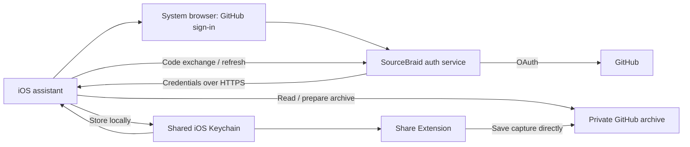

# SourceBraid: Setup assistant and GitHub connection in iOS

**SourceBraid — Weave the web into Markdown.**

As of: **October 12, 2026** · Status: **Implementation proposal; not implemented or approved for release**
· [Deutsche Version](IOS_ONBOARDING_INSTALLER_PLAN.de.md)

## 1. Recommendation and goal

**Yes: the iOS app should become the main entry point for SourceBraid.** The
“installer” is primarily a guided setup assistant inside the app. It connects
GitHub, creates a private archive or connects an existing one, checks that it
can be used, and guides the user to their first saved clip. Chrome and
ChatGPT/Codex are then offered as optional additions.

The goal for new users is: **Install the app → sign in to GitHub → confirm a
private archive → save the first item.** Nobody needs to understand Git,
branches, Personal Access Tokens, or a terminal to do this. A GitHub account,
sign-in, and explicit authorizations remain necessary; SourceBraid does not
automate account verification or two-factor authentication.

Recommended technical direction:

- A **GitHub App** registered by the maintainer, which users authorize for
  their archive. Users do not create their own developer app.
- Browser sign-in from iOS with PKCE and a small SourceBraid service for
  securely exchanging and renewing credentials.
- Direct capture transfers between iOS and GitHub. Markdown and Git history
  remain authoritative; local databases are rebuildable caches.
- Automatic creation of a private archive after an early technical proof of
  feasibility; a guided GitHub form remains a simpler first stage.
- Existing PAT configurations continue to work. Manual entry moves to
  “Advanced setup.”

This document plans the work. It does not register a GitHub App, operate a new
service, or change existing privacy commitments. It complements the
[iOS reader plan](IOS_READER_INTELLIGENCE_DUO_PLAN.md); that plan’s local
development candidate and device acceptance remain a separate workstream.

## 2. Current repository state

The following findings refer to the inspected local working tree, including
existing uncommitted iOS changes. They do not state which features are already
available in the App Store.

| Area | Available today | Missing for simple setup |
| --- | --- | --- |
| [iOS settings](../ios/SourceBraid/App/SettingsView.swift), [ViewModel](../ios/SourceBraid/App/SettingsViewModel.swift) | Form for owner, repository, branch, archive folder, and token | Guided sign-in, archive selection, creation, understandable states |
| [GitHubClient](../ios/SourceBraid/Shared/GitHubClient.swift) | Repository query, capture writes | Complete checks for branch, privacy, write capability, and PDF support |
| [Configuration](../ios/SourceBraid/Shared/SourceBraidConfiguration.swift), [Keychain](../ios/SourceBraid/Shared/KeychainStore.swift) | Shared settings and one token for app/Share Extension | Authentication type, expiry, refresh, account binding, and safe migration |
| [Reader](../ios/SourceBraid/Archive/ArchiveLibrary.swift) | Reading, search, and local cache management in the development candidate | Friendly state for a new, still-empty archive |
| [Setup script](../scripts/setup_github.py), [package builder](../scripts/build_setup_package.py) | Private repository, support files, and configuration without a token | Python and an authenticated `gh` are required; manual PAT creation remains the final step |
| [Chrome extension](../chrome-extension/sourcebraid/popup.js) | Manual settings, capture, and plugin configuration export without a token | Sign-in and import of a configuration prepared by iOS |
| [Hosted ChatGPT](../chatgpt-mcp/src/auth.mjs) | Prepared OAuth service with per-user grants | GitHub sign-in instead of a separate PAT; deployment and public release approval |
| [Local Codex plugin](../codex-plugin/sourcebraid/scripts/sourcebraid.py) | Python standard library, local search, existing GitHub credentials | Optional simpler configuration import; not part of basic iOS setup |

Two specific weaknesses belong in the first implementation step:

1. “Test connection” currently saves the new configuration before checking the
   network. A failed attempt can therefore switch the existing archive and
   remove its local cache. The assistant needs a draft that becomes active
   only after successful validation.
2. The current connection check reads only repository metadata. This proves
   neither that a branch exists nor that a capture succeeds. “Connected,”
   “Reading available,” and “Saving verified” must become separate states.

The setup script is a good reference for allowed files and repeatability.
However, its blanket enabling of GitHub Actions with `allowed_actions: all`
should **not** be carried into the new assistant.

## 3. What the installer should do

### Required scope of the first user-friendly version

- Get started without a terminal, Python, or GitHub CLI.
- Explain in everyday language: “Your archive is a private folder on GitHub.
  The files belong to you and remain usable independently of SourceBraid.”
- GitHub sign-in, understandable repository authorization, and account display.
- Create a new private archive or connect an existing archive.
- Detect technical fields automatically; show them under “Advanced” only when
  needed.
- Initialize, resume after interruption, and validate with specific recovery
  actions when errors occur.
- Introduce iOS sharing and guide the first real capture, including reading it
  back.
- Provide a “Connections” area that remains accessible for renewal and repair.
- Complete German and English text, VoiceOver, and Dynamic Type.

### Deliberately deferred

PDF conversion, Chrome connection, hosted ChatGPT, and local Codex setup must
not block a successful basic start. Apple Intelligence is not required either.
A separate desktop installer is initially a lower priority; the existing
script remains available for technical users and as an independent route
without an iPhone. Android remains on the roadmap.

## 4. Sign-in: options and decision

| Option | Benefit | Effort and limitation | Role |
| --- | --- | --- | --- |
| Guided fine-grained PAT | Small change; existing clients remain compatible | The token still needs to be created, copied, and later replaced | Transition and expert route |
| GitHub App, browser flow + PKCE + auth service | Understandable sign-in; targeted repository authorization; automatic renewal | Operating a small service and new credential handling | Recommended product goal |
| GitHub App, device flow | No app secret in the client; no dedicated token exchange service required | Code entry, polling, and increased phishing exposure | Evaluate as a justified alternative, not the iOS default |
| OAuth App | Familiar sign-in route | Private repositories typically require broad `repo` access | Lower priority than a GitHub App |
| Desktop script with `gh auth login` | Much is already available | Additional installation and terminal knowledge | Addition for advanced users |

For comparison of the breadth of OAuth App access:
[GitHub: OAuth scopes](https://docs.github.com/en/apps/oauth-apps/building-oauth-apps/scopes-for-oauth-apps).

GitHub documents PKCE in the web flow but still requires a `client_secret`
during code exchange. The plan therefore does not promise a purely native web
flow without a secret. The auth service is our architecture decision for
keeping that secret on the server.
[GitHub: User access token flow](https://docs.github.com/en/apps/creating-github-apps/authenticating-with-a-github-app/generating-a-user-access-token-for-a-github-app#using-the-web-application-flow-to-generate-a-user-access-token)

GitHub prefers PKCE over device flow and recommends the latter only where a
justified need exists in constrained environments. A client secret embedded
in a native app would not be confidential either. Device flow therefore does
not become the default solely to save server work.
[GitHub: Best practices](https://docs.github.com/en/apps/creating-github-apps/about-creating-github-apps/best-practices-for-creating-a-github-app#client-secrets)

For the existing PAT route, a GitHub link can prefill the name, owner, expiry,
and Contents permission. The user must check that the single archive repository
is selected; the link does not create a token automatically. Tokens belong
only in the protected input field, never in a chat, QR code, support ticket,
or configuration export.
[GitHub: PAT templates](https://docs.github.com/en/authentication/keeping-your-account-and-data-secure/managing-your-personal-access-tokens#pre-filling-fine-grained-personal-access-token-details-using-url-parameters)

## 5. The user journey

| Step | Display and action | What SourceBraid handles |
| --- | --- | --- |
| 1. Welcome | “Your own knowledge archive”; “Set up” or demo | Brief explanation of GitHub and private ownership |
| 2. Connect GitHub | “Connect to GitHub”; alternatively “Create a GitHub account” | Browser sign-in, return, and verification of the signed-in account |
| 3. Choose archive | “New private archive” or “Existing archive” | Suggest `sourcebraid-archive`, check for name collisions, and offer existing choices |
| 4. Confirm access | GitHub displays SourceBraid and the repositories to authorize | Guide selection of exactly the archive; verify the actual installation afterward |
| 5. Prepare archive | “Preparing archive” with named substeps | Determine the branch, initialize the archive folder with `.gitkeep`, preserve existing files |
| 6. First save | Short guide for Safari → Share → SourceBraid | Save an actual capture and reopen it in the app |
| 7. Done | “Your archive is ready” | Optionally connect PDF, Chrome, or ChatGPT; all can be skipped |

The order of archive creation and installation authorization depends on the
chosen bootstrap method; the interface shows only the next step needed at
that point. Signing in to GitHub and installing the GitHub App are separate
authorizations. Successful sign-in alone does not establish archive access.

Defaults apply only to new archives. Existing names, folders, and branches are
not renamed. In particular, the actual default branch is detected instead of
assuming `main` everywhere. The previous name `sourcebraid-private` is no proof
of privacy and must not be confused with the maintainer’s private authoring
repository.

No test silently creates an apparently real article. An optional synthetic
setup file must be announced as such. A capture initiated by the user with
correct provenance is the strongest evidence for successful completion.
Read-only access remains a usable mode with the message “Authorization to
save is missing.”

## 6. Technical architecture for iOS

Apple provides `ASWebAuthenticationSession` as a system mechanism for web
sign-in. We use it instead of a custom password form or the capture WebView.
Implementation preserves the existing iOS 17 support and checks callback API
availability.
[Apple: ASWebAuthenticationSession](https://developer.apple.com/documentation/authenticationservices/aswebauthenticationsession)



### Responsibilities of the auth service

The service keeps the client secret in a protected server environment and
supports sign-in and refresh. It does not proxy archive files and, in the
basic model, does not need a GitHub App private key to mint installation
tokens. iOS uses GitHub App user access tokens.

Planned contract:

1. iOS starts a short-lived sign-in with random `state` and PKCE S256.
2. The service binds the transaction to the initiating app session and an
   exactly allowlisted callback address; no arbitrary redirect destinations
   supplied by callers.
3. GitHub authenticates the user. On return, state, expiry, and the binding
   to the original request are checked.
4. A one-time return code is redeemed from the app over HTTPS. The verifier
   and code exchange must belong to the same PKCE transaction. GitHub tokens
   must not enter callback URLs or browser histories.
5. The service exchanges the GitHub code using the server-side secret and
   delivers the tokens only to the initiating app. The app checks GitHub
   identity and archive access before activation.
6. Token renewal uses a protected endpoint bound to the session. It must not
   be an open token proxy or arbitrary HTTP proxy.

The broker session proof must remain verifiable after the app restarts and
the GitHub access token expires. O00 defines its secure storage, binding to
the authorized connection, lifetime, renewal, and revocation. An ordinary
refresh should not require another browser sign-in; an expired or revoked
broker session may require one.

This is an interface draft to be reviewed, not a newly invented OAuth
protocol. A maintained OAuth implementation and a security review must cover
replay, login CSRF, app impersonation, and failed handoffs.

**Privacy impact:** The service processes tokens at least transiently and
therefore cannot be advertised as having “no access to credentials.” The
proposal calls for no persistent token storage for iOS, no content database,
and no logging of tokens, codes, or request bodies. Short-lived session data,
operational metadata, retention periods, hosting, and secret rotation must be
defined before release. The existing Cloudflare infrastructure is a possible
hosting route, not an already available native sign-in solution.

### Lifecycle and Share Extension

The shared Keychain receives a versioned credential model with authentication
type, stable GitHub user ID, app/installation association, access and refresh
tokens, and expiry times. Nonsecret archive configuration remains separate.
Existing Keychain and App Group identities are preserved.

GitHub documents defaults of eight hours for user access tokens and six
months for refresh tokens; a successful refresh invalidates the old pair.
The implementation uses the returned expiry values and checks the app
configuration that is actually enabled.
[GitHub: Refresh](https://docs.github.com/en/apps/creating-github-apps/authenticating-with-a-github-app/refreshing-user-access-tokens)

The app and Share Extension must not consume the same refresh token
concurrently. Cross-process coordination, rereading after acquiring the lock,
and atomic replacement of the credential set are required. A refresh timeout
must not trigger a blind retry loop; if the new token pair is lost, signing
in again is an intended recovery route. The extension has a short execution
window: when necessary, clearly direct users to “Open SourceBraid and renew
the connection.” A failed upload must never be reported as saved.

## 7. Archive creation and permissions

### A. Smallest releasable route

The assistant opens a prepared GitHub form for a private repository. It then
guides installation of the GitHub App with the archive selected. Afterward,
it uses the API to check repository ID, owner, private status, and actual
access; form values and return parameters are not trustworthy confirmation.

Example of the documented form route:
[Prepare a private archive on GitHub](https://github.com/new?name=sourcebraid-archive&visibility=private&owner=%40me).
[GitHub: Repository form parameters](https://docs.github.com/en/repositories/creating-and-managing-repositories/creating-a-new-repository#creating-a-new-repository-from-a-url-query)

### B. Preferred convenience goal: creation directly from the app

The current GitHub documentation lists **Repository creation** as a narrower
permission than Administration and describes automatic access to repositories
the app creates. This makes direct creation feasible in principle.
[GitHub: Choosing permissions](https://docs.github.com/en/apps/creating-github-apps/registering-a-github-app/choosing-permissions-for-a-github-app)

After installation/authorization, iOS calls `POST /user/repos`, explicitly
with `private: true`. The response provides the repository ID to verify.
Access is then checked again through the installation, and the archive is
initialized. The public API default must never be used accidentally.
[GitHub: Create a repository](https://docs.github.com/en/rest/repos/repos?apiVersion=2026-03-10#create-a-repository-for-the-authenticated-user)

**Early proof O00:** a fresh account without a repository, actual availability
of the creation permission, installation with zero/selected repositories,
automatic access, an existing installation with a declined permission
upgrade, name collision, and a timeout immediately after creation. This
sequence has not been exercised in practice for this plan. If the proof
fails, implement route A first. Do not fall back broadly to administration
permissions or all repositories.

### Target permission model

| Function | Planned access | Boundary |
| --- | --- | --- |
| Reading | Read Metadata and Contents | Independent read-only mode |
| Capture | Write Contents in the selected archive | No general repository administration permissions |
| New archive | Separately justified Repository creation permission for route B | Route A needs no authority to create repositories |
| PDF setup | Write Contents and Workflows for the support files | Separate setup step, not a default capture permission |
| PDF status | Read Actions only if necessary | No automatic changes to organization policies |
| Hosted ChatGPT | Its own GitHub connection limited to reading | No forwarding of the iOS write token |

The specific API endpoints and permissions will be verified in O00 with
minimal test accounts, particularly
[Contents write access](https://docs.github.com/en/rest/repos/contents#create-or-update-file-contents)
for normal files and workflow files. GitHub App permissions are tied to the
registration and are not freely switchable OAuth scopes. An optional PDF
toggle does not retroactively make a globally requested workflow permission
optional. For the first version, PDF setup uses a separate, narrowly scoped
setup route; a separate setup app may follow later. Each additional app
increases usability complexity and must provide a demonstrable benefit.

Existing archives are connected only after selection. Personal accounts are
the first fully supported setup route; organizations, SSO, and pending admin
approvals receive their own states. Rules and branch protection are not
disabled to force a capture through.

## 8. Initialization and PDF conversion

Bootstrap receives an explicit file list and becomes repeatable:

- Prepare a new archive with an initial commit and `<archive-folder>/.gitkeep`.
  Git does not store empty directories. An archive without captures then
  becomes a valid state; an archive folder that has not yet been created
  must also be handled clearly during first setup.
- Create only planned files. Compare and preserve existing files; show
  conflicts. Do not overwrite for convenience.
- After an ambiguous network response, check remotely first whether the step
  has already completed. No second repository or duplicate test capture.
- Document setup steps and remaining work without secrets. Cancellation does
  not delete a repository that has already been created.
- Preserve capture paths, YAML frontmatter, and URL-hash index shard formats.
  A new configuration schema requires explicit versioning and migration.

PDF remains a separate step, “Automatically convert PDFs to Markdown.”
Reuse the existing allowlist:

```text
.github/workflows/convert-pdfs.yml
requirements-docling.txt
scripts/convert_pdfs.py
scripts/push_with_retry.py
```

The files come from the verified public project sources and are bundled with
a pinned version. Neither `website/` nor a private `web-clips/`, local
configuration, or Git history is copied. The private authoring repository is
not forked or exported either.

The PDF step explains processing through GitHub Actions and possible
quotas/costs, without promising unlimited free operation. A synthetic PDF
checks the actual end-to-end run. “PDF uploaded,” “Conversion pending,” and
“Markdown available” remain separate. When Actions are disabled, normal
saving, reading, and search remain usable; pending PDF conversion is visible
rather than reported as complete.

## 9. Connect Chrome, ChatGPT, and Codex as additions

### Chrome

After basic iOS setup, the app can provide a configuration without credentials.
Existing keys remain compatible:

```json
{
  "owner": "example-user",
  "repo": "sourcebraid-archive",
  "branch": "main",
  "root_folder": "web-clips"
}
```

This is a synthetic example, not a real configuration. Chrome first needs
an import dialog with a preview, strict path validation, and its own GitHub
sign-in. Imported values do not grant access. OAuth callbacks, Manifest V3
service worker restarts, and any necessary new browser permissions receive
targeted checks. No iOS tokens, cookies, or refresh tokens are transferred to
the extension.

Later QR code pairing may contain only configuration or a short-lived,
one-time pairing proof bound to the session. Repository names must also be
treated as private. Installation and authorization of the Chrome extension
take place in the browser; the iOS app can guide them but cannot silently
install the extension.

### Hosted ChatGPT

The [prepared MCP integration](CHATGPT_MCP_DEPLOYMENT.md) already has per-user
OAuth grants. However, its OAuth connects **ChatGPT to SourceBraid**. The
consent page still requests a separate GitHub PAT. This sign-in does not yet
solve the GitHub token problem.

Expansion requires an independent read-only GitHub connection, preferably a
separate GitHub App registration without write permissions. Consent and the
association with a user, installation, and exactly one archive are checked
on the server. The existing code explicitly accepts `github_pat_` and
determines identity through `/user`; installation tokens are therefore not
an interchangeable substitute. Credential type, authorization, and renewal
must be deliberately adapted and tested with two separate test accounts.

Between ChatGPT and MCP, a dedicated OAuth flow with PKCE, resource binding,
and token validation remains necessary. A GitHub token is not an MCP access
token.
[OpenAI: Plugin authentication](https://developers.openai.com/plugins/build/auth)

This hosted route processes requested content at SourceBraid/Cloudflare and
OpenAI. It receives its own consent and privacy description. The iPhone does
not become a permanently reachable MCP server. The connection must work
independently of a running iPhone. Public availability is announced only
after deployment, testing, and approval; before that, the app does not show
a connection button that appears to work.

### Local Codex plugin

The existing route with a local Python runtime and GitHub access remains
available. Configuration from iOS can simplify it later. The standard library
remains sufficient; this plan requires no new Python package. Reading and
confirmed write/delete actions retain separate requirements. No ChatGPT or
Codex account is required for basic iOS features.

## 10. States, errors, and recovery

The assistant stores a draft separately from the active configuration.
One possible sequence is:

```text
unconfigured → authenticating → choosingArchive → authorizingArchive
→ provisioning → readReady → captureVerified → completed
```

`cancelled`, `offline`, `authorizationPending`, `reauthRequired`, and
`repairRequired` are resumable states. PDF and additional integrations are
separate capabilities, not required states in this sequence.

| Situation | User guidance / required behavior |
| --- | --- |
| Sign-in cancelled | Return to the previous page; existing connection remains active |
| Wrong GitHub account | Display the account clearly and offer an explicit account switch |
| 401 / revoked token | Renew once where appropriate or sign in again; no infinite loop |
| 403 / missing permission | Identify the missing authorization; distinguish organization approval from rate limits |
| 404 | Distinguish missing visibility, wrong repository, missing branch, and empty archive |
| Public repository | Require a private alternative in the beginner route; do not automatically change an existing repository |
| Name taken | Check an existing archive or suggest another name; overwrite nothing |
| Protected branch | Explain the block; explicitly choose an allowed branch while preserving protection |
| Interruption after creation | Find the existing repository and continue; no automatic deletion |
| Offline / rate limit | Preserve progress, retry with backoff, keep existing cache usable |
| New device / reinstalled app | Sign in again and select the existing archive; no duplicate creation |
| Share Extension without valid access | Clear error message and repair in the main app |

“Sign out on this device,” “Revoke GitHub authorization,” “Remove local data,”
and “Delete repository” are different actions. The assistant does not delete
archives. Revoking GitHub App authorization can affect other devices;
independent revocation per device is not promised without verification.
[GitHub: Revoke authorization](https://docs.github.com/en/apps/using-github-apps/reviewing-and-revoking-authorization-of-github-apps)

## 11. Implementation packages and order

Estimates are person-days for development and testing, not commitments.
App Store review, operator approvals, and waiting times are excluded.

| Package | Work and affected areas | Outcome / acceptance | Rough size |
| --- | --- | --- | --- |
| O00 – Feasibility | Test GitHub App, web flow/PKCE/refresh, creation permission, and selected repositories | Written API/permission evidence, decision between archive routes A and B, and hosting contract | 2–3 days |
| O01 – Assistant and transition | New onboarding views, SettingsViewModel, draft state, guided PAT route | Existing PAT users retain access; errors do not destroy a working configuration | 3–5 days |
| O02 – Sign-in | Auth service, AuthenticationServices, callback configuration, credential model | Login/cancellation/refresh/revocation, including negative security tests | 4–7 days |
| O03 – Archive | Repository selection/creation, branch detection, idempotent bootstrap, empty reader | Fresh private archive and existing archive successfully verified | 3–5 days |
| O04 – First save | Share Extension, refresh coordination, capture readback, repair UI | Physical device saves and reads the first real capture | 2–4 days |
| O05 – Release acceptance | DE/EN, accessibility, migration, privacy text, operations, and device checks | First version ready for approval without mandatory additional integrations | 3–5 days |
| O06 – PDF | Separate permission/setup route and conversion status | Complete synthetic PDF conversion; normal archive usable independently | Estimate separately afterward |
| O07 – Chrome | Configuration import, own sign-in, optional pairing later | Same archive usable, no token forwarding | Estimate separately afterward |
| O08 – ChatGPT/Codex | Read-only GitHub connection for the MCP service, local import | Separate permissions and working account isolation | Estimate separately afterward |

O00–O05 total approximately **17–29 person-days**. O00 may change this range.
A guided PAT assistant is a useful early intermediate step but does not yet
meet the goal of “no manual token creation.” It must not count as completion
of this product improvement.

Proposed new iOS components: `OnboardingCoordinator`,
`GitHubAuthorizationClient`, `GitHubRepositorySetupClient`, and
`CredentialProvider`. These names are drafts, not existing files.
Capture code remains focused on its existing format.

## 12. Tests and mandatory acceptance criteria

### Automated

- State transitions, draft/activation, cancellation, and migration of old settings.
- PKCE, incorrect `state`, foreign callback URL, replay, expired session,
  lost token response, and concurrent refresh from app/extension.
- User/repository/installation binding, foreign repository ID, and two
  separate accounts; no access through manipulated configuration imports.
- New/missing branches, empty archive, existing files, name collision,
  timeout after commit, and repeated bootstrap.
- Read-only access, denied writes, branch protection, PDF without a workflow.
- No secrets in logs, diagnostic exports, URLs, packages, or screenshots.

### On physical devices and with GitHub test accounts

- Fresh account without a repository through to the first capture; connect
  an existing archive without overwriting it.
- Existing PAT users migrate only after successful new sign-in.
- Sign-in with two-factor authentication, cancellation, and the wrong account.
- App backgrounding, interrupted connection, token expiry, revocation,
  reinstallation, and Keychain access before the first unlock.
- Safari sharing, other share sources, iPhone/iPad, VoiceOver, large text,
  German and English, and the oldest supported iOS version.
- Five people without GitHub experience test the flow. Target: at least four
  complete their first capture without personal assistance; setup time and
  abandonment points are observed with consent. This is a proposed product
  goal, not a measured result or a new telemetry requirement.

### Repository checks during later implementation

For shared capture, script, or plugin changes, run both core suites from the
repository root:

```bash
node --test tests/capture-utils.test.js
python3 -m unittest discover -s tests -p "test_*.py"
```

Build iOS from `ios/` without signing and additionally run the new unit/UI
tests on a suitable simulator:

```bash
xcodebuild \
  -project SourceBraid.xcodeproj \
  -scheme SourceBraid \
  -sdk iphonesimulator \
  -destination 'generic/platform=iOS Simulator' \
  CODE_SIGNING_ALLOWED=NO \
  build
```

For changes to the hosted service, also run its `npm ci`, `npm test`, and
`npm run build` under `chatgpt-mcp/`. Define dedicated tests/build checks
for a new auth service. Document missing platforms or dependencies openly;
builds replace neither live OAuth nor device acceptance.

**The first version is complete** when the normal iOS route works without
PAT creation, a terminal, or an additional plugin; a private archive is
verified to belong to the user’s account; a capture is successfully read
back; and cancellation, renewal, and existing archives are handled reliably.
PDF and additional integrations have their own acceptance criteria.

## 13. Questions to resolve before release

1. **Operations:** Who owns the auth service, domain, secrets, monitoring
   without content/token logs, outages, abuse protection, and recovery?
2. **Permissions:** Which actually tested GitHub App registration provides
   the minimum necessary access? Will direct creation be approved immediately?
3. **Privacy:** Update new authentication processing, operators, retention,
   and revocation in [PRIVACY.md](../PRIVACY.md), iOS notices, and store
   disclosures; do not weaken legal text without maintainer review.
4. **Distribution:** The iOS app remains the main entry point. Show only
   real published store/plugin links; clearly distinguish development packages.
5. **Migration:** Preserve the PAT fallback, do not rename existing archives,
   and keep Keychain and formats compatible.
6. **Release:** Include only public allowlisted files, no private sources or
   history; observe required checks and DCO sign-off.

The next concrete implementation step is **O00**: a small, isolated proof
of sign-in, refresh, and private archive creation with minimal permissions.
The assistant and authentication can then be implemented against a verified
contract.
